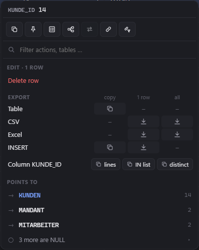
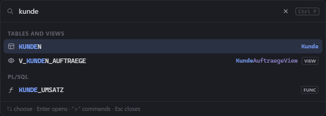
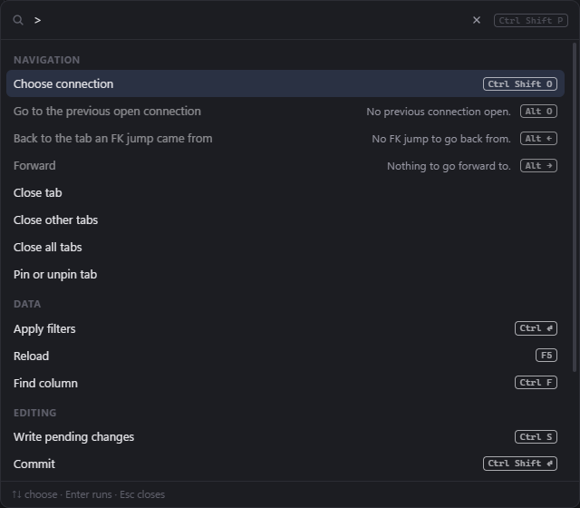

# Changelog

All notable changes to this project are documented here.
The format follows [Keep a Changelog](https://keepachangelog.com/en/1.1.0/), versions follow [SemVer](https://semver.org/).

## [Unreleased]

### Fixed
- The schema comparison no longer freezes the window. Its sessions were opened and read on the UI thread, where the driver's synchronous steps (the session settings after logging in) held the window for a round trip per connection – over a slow VPN a second or more –, and the matrix was computed there too; both now run in the background. Turning on "Only differences" or a kind filter no longer computes the matrix again. A large matrix shows its first 300 objects and adds 300 more per click, with the number of the others below.

### Changed
- The schema comparison shows the group of a connection: the list of a side reads "Kunde A › DEV" and is ordered like the connection switcher – by group (connections without one last), then kind and name –, and the column headers of the matrix and its export carry the group too, so two groups' connections of the same name stay apart. The list to choose the connection of an app's statements from does the same: the suggested connections first, then all others by group. With "Group before the connection name" off, all of them show the bare name as before.
- The connection switcher is wider (720 instead of 560 pixels), so the group in front of the name of an open or recent connection is cut less often.
- The "+n" handles of the relationship and record diagrams show chevrons pointing to where the tables or rows appear, in the colour of the relationships behind them – constraint, C# model or other, like the edges –, neutral if they mix kinds. Their tooltip counts the relationships per kind ("Relationships: Constraints 2 · C# model 1").

## [3.49.0] - 2026-10-25

The menus of a cell and a column header are rebuilt – a bar of icons, a filter field to type into, the export as a table of formats, the values of a column as chips –, the column header menu says what the column is and adds it to another database, and all icons are redrawn from Lucide.

### Changed
- The right-click menu of a cell – in a table and in a query result – is rebuilt; it had grown to some 40 lines. The single actions are icons in a bar at the top, named in their tooltips: copy the value, copy it as C# value, open a LOB, pin the column, form or comparison, connected records, copy to another connection, link to the rows, link to the view. Typing goes straight into a filter field below and narrows actions, formats and foreign keys; ↑ ↓ move through the entries, Enter runs one, Esc clears the filter, then closes the menu. The export is a small table of formats – table, CSV, Excel, Excel with raw values, INSERT, C# objects, HasData – by copy, save the selected rows and save all rows of the filter, with a dash where there is no such combination. The values of the clicked column are chips beside it: lines, IN list, distinct. Foreign keys take one line each, with the key's value or the number of rows referencing; those without a value fold into "3 more are NULL" and a long list of tables referencing into its first eight and "… more" – a click opens them, the jumps over the clicked column always stay in sight. Editing rows and marked cells stay lines below the filter.

  

- The menu of a column header shows what the column is: NULL allowed or NOT NULL, primary key, the tables its foreign keys point to (relationships of the C# model too), its C# property with its type, and its comment. Below come Pin, Select, Display (the table's display column, outlined when it is one) and Name, which copies the column's name, then all values of the filter as chips (lines, IN list, distinct), and the tables its foreign keys point to, opened with a click. A query result's column header has Select, Name and the chips.

  

- All icons are redrawn from [Lucide](https://lucide.dev) – the shapes are clearer at their small size and come from one set. Comparing the selected rows has its own icon (two linked points) instead of the one of the schema comparison, which is now a sheet with a diff; the link to the view is a bookmark beside the chain of the link to the rows, and the row as a form a sheet with lines. Buttons and marks that were characters of the font – close, fold, "more", arrows, undo and redo, run, warnings, zoom and the handles and buttons of filter rows (✕ ▾ ⋯ ← → ↶ ↷ ▶ ⚠ ⠿ − +) – are icons of the same set; a stored procedure is now a square with a play sign, as "Run" keeps the plain one. Nothing is loaded from outside: the shapes are part of the app, under Lucide's ISC license.

### Added
- "distinct" copies the values of a column each once, one per line in the order they first come, without NULL – in the cell menu from the selected rows, in the column menu all values of the filter or the result (a table reads them with `SELECT DISTINCT`).
- The column header menu of a table adds the column to the same table on another database, like the "Columns" view: "Copy" gives its `ALTER TABLE … ADD`, a connection opens it in a SQL tab there. With whole columns selected (Ctrl+click on the headers) it takes all of them. The menu of the "Columns" view is built the same way and gets a filter field for the connections when there are more than eight.

## [3.48.0] - 2026-10-23

Query results and the columns and usage views can be sorted by their headers, columns can be added to the same table on another database, and "Usage" says when projects that are not built make "unused" uncertain – and builds them.

### Added
- The result of the SQL editor and the LINQ console can be sorted by a click on a column header, Shift+click adds a column, as in a table. Once every row is loaded – a result of up to 500 rows at once –, the rows are sorted in memory, without reading them again, in the order Oracle gives them (text by its characters, NULL last ascending); rows with the same value keep the query's own order. Before that the query is read again sorted by the column: in front of its own ORDER BY, which then breaks ties, and around the query when it limits its rows with `FETCH FIRST` or `OFFSET` – then only those rows are sorted. A query that limits its rows and has two columns of the same name can only be sorted once all its rows are loaded; the header says so. Copying all values of a column, marked cells and exporting all rows follow the order.
- The "Columns" and "Usage" views of a table sort their rows by a click on a header: ascending, descending, then back to the table's own order. Rows without a value (a column without property or comment) stay last; "Usage" sorts by the reads and writes in the application's code, then in tests.
- Columns of a table can be added to the same table on another database: pick rows in the "Columns" view (click, Ctrl+click, Shift+click) and right-click. "Copy as ALTER TABLE … ADD" copies one `ALTER TABLE … ADD` per column – type, default, identity or virtual expression, `NOT NULL` – and `COMMENT ON COLUMN` for their comments; a mandatory column without default carries the warning that it fails on a table with rows. Below, the other connections: one opens a SQL tab there with the script, connecting if need be, and nothing runs until you run it (with the confirmation of DDL as always). The script names the table as it is found there – same owner, same name in that connection's schema, or a synonym –, so Test and Prod may have different schema names; a connection that is not open yet gets the name in the schema it shows.
- "Usage" and the report of unused properties say when "unused" may be wrong: projects of the solution that can use the model (they reference the project with the entities, directly or through others) but are not built have no uses to read. "Build projects" beside the note runs `dotnet build` of the solution in the linked configuration and reads the new builds afterwards – also after a failed build, which shows its output. "Cancel" beside the running build stops `dotnet build` and reads what was built until then. Projects that cannot reach the entities (a tool, an installer) no longer count: not built, they cannot make "unused" wrong. Neither do test projects not built – "unused" leaves tests out anyway; they are known from the project file (`IsTestProject`, or a package of xUnit, NUnit, MSTest, TUnit or the test SDK). The "unused" mark says the same in its tooltip.

## [3.47.1] - 2026-10-23

Fixes for the connected-records diagram, and more in the log about a lost connection.

### Fixed
- Connected records: a tab opened or restored before the C# model was loaded showed no rows along the model's relationships on a side that had none without it (a header row without its positions, say), also after the model came – the expansion of that side was not remembered, and the tab was saved that way. It is now, and so is every step that has nothing to do when the tab is read again (a row deleted for now, a relationship not loaded yet), so it comes back with the row or the model.
- Connected records: "+3" on a row with several relationships on that side could crash the tab ("The given key … was not present in the dictionary") while the rows were read – the rows of the first relationship were drawn before they had a place in the diagram. They now appear when the read ends.

### Changed
- The log says more about a lost connection: how long the session had been idle, when it last cancelled a command on the server and how that command ended, and how many commands followed – to tell a network drop from a session a cancel left out of step. A look at a running statement that is cancelled when the statement ends is logged too, and so is a connection the keep-alive ping found lost. No statement text or values go into it.

## [3.47.0] - 2026-10-23

Rows can be copied into another connection together with everything that hangs on them, a table's relationships and a row's connected records show as diagrams, and the type and NOT NULL lines of the column headers can be switched off.

### Added
- Copy rows into another connection, with what hangs on them (cell menu › "Copy to another connection…"): the selected rows go into a workspace of another open connection – customer 4711 from Prod into Test, say –, together with every row they reference, up the whole chain (the order's customer, the clerk, the clerk's manager …), and the rows that reference them along the relationships you tick, up to three levels deep (by default the children one level down). Both are trees in the dialog: switch off a parent relationship whose rows the target has already (master data, say) – the check then looks them up there –, and after reading each strand shows how many rows it brought. Relationships of the C# model count like constraints. "Read rows" collects them and checks them against the target before anything is written: the tables of your schema go to the target connection's schema, columns are matched by name, columns the target lacks or types that differ are named (values of another type are converted as if typed into the grid; one that does not convert stops the copy), an identity `GENERATED ALWAYS` key or a `NOT NULL` column only the target has stops the copy, and triggers that will fire are mentioned. Rows the target has already are skipped – or, per table, updated or the copy aborted; one whose other columns differ there is named, since it may be another record under the same ID, and a new row that a unique key of the target holds under another ID stops the copy before anything is written. The copy is one action in the target workspace's transaction, parents before children (an employee's manager first), inserted 500 rows at a time in one round trip: ↶ takes it back as a whole, and nothing is committed until you commit. A locked Prod workspace has to be unlocked first; Prod as the source is fine, it is only read. At most 10,000 rows.
- A table tab has a new view, "Relations": the table in the middle, the tables it references to the left, those that reference it to the right, as a diagram – nothing is read from the database for it. Lines are colored by kind (constraint, C# model) and dashed without a constraint; hovering a table brings out its relationships, a line's tooltip names its columns. "+3" on either side of a table shows its hidden neighbors there, a click on the name opens the table, the right-click menu puts it in the middle. "Levels" shows one or two levels, more than 12 new tables on one side become one node until you show them, and a kind of relationship can be switched off. Zoom with − and +; "Copy as Mermaid" gives an `erDiagram` for documentation and tickets. What you expanded stays when you reload (F5) or the C# model arrives.
- Connected records as a diagram (cell menu › "Show connected records"): a new tab shows the selected rows with the rows they reference to the left and those that reference them to the right – order 4711 with its customer and clerk, its positions and invoices –, each row with its table (or entity) name, its key and the value of the display column. "+3" on either side of a row loads the rows along its relationships there, the right-click menu follows one relationship at a time; more than 12 new rows along one relationship become one node ("POSITION ×200") until you show them, and a relationship that leads to more than 2,000 rows is not read but offered as a filtered tab. A click on the name opens the row's table filtered on it. Click rows to mark them and copy them – rows of one table – to another connection with what hangs on them. The tab is read in its workspace's session (uncommitted rows included), "Copy as Mermaid" gives a flowchart with the values shown, and the tab is saved with the workspace: the start rows and what you expanded come back after a restart, read again.
- The preview of "Copy to another connection…" can be shown as a diagram too: the tables in the order the rows go in, each with its rows, new and existing ones and the conflict mode, the border in the color of the worst finding of the check.
- Settings › Data view: the Oracle type and `NOT NULL` in the column headers can each be switched off – in the grid of a table and in the result of a query. With both off the header loses that line and gets lower; what it hides shows in the header's tooltip.
- "SQL" in the filter bar can show `SELECT t.*` with the filter and the sorting only (Settings › Data view › SQL of a filter) instead of the grid's own statement with ROWID, each column, LOB previews and the first page – shorter to read and to go on with in the SQL editor. A table without primary key still ends the order with `t.ROWID`, so the SQL editor reads every row exactly once when it pages. The grid's statement stays the default.

## [3.46.0] - 2026-10-22

Cells and whole columns can be marked and copied in the grid, one value set for many cells at once (with Del for NULL and Ctrl+D to fill down), and a lost connection can be reconnected automatically.

### Added
- Reconnect automatically (Settings › Connection, off by default): a lost connection is connected again by itself and its workspaces are restored where you are – FerretSharp neither switches to it nor jumps to the explorer, and one in the background is reconnected too. While the network or the database is away (the VPN after sleep, a restarting instance), it tries again after 5, 15 and 30 seconds, then every minute, for up to 10 minutes after the loss: the connection shows "Connection lost" with the time to the next attempt, "Try now" and "Stop trying", the switcher marks it "reconnecting". It only does so when no workspace of the connection had uncommitted changes – when some were lost, the banner says so and waits for "Reconnect" as before –, waits for a running write or export to end first, and never tries again after a refused login (another wrong password could lock the account). Workspaces unlocked for writing are read-only again; the notice after reconnecting names them.
- After the computer wakes from sleep, idle connections are checked after a few seconds instead of up to two minutes later, so a connection that died meanwhile shows up (or is reconnected) before the next click.
- Select cells and whole columns in the grid, like in Excel – AG Grid has this only in its paid edition. Dragging from one cell into another selects the cells between (beyond the edge the grid scrolls on, the faster the farther out), Shift+← → selects from the focused cell, then Shift+↑ ↓ and Shift+Page↑/↓ extend it, as does Shift+click; a click still selects the row, Esc clears. Ctrl+click on a column header selects the whole column instead of sorting, Ctrl+Shift+click the columns up to it, and the header menu has "Select column" (tables and SQL editor). Ctrl+C copies the cells tab-separated as shown, pending changes included; the cell menu offers them also as a table with headers and – for one column – as an IN list. Rows of a range that were never loaded are read first; selected columns mean all rows and are read again in the background like "Copy values" – up to 100,000 cells. The footer shows "3 × 4 cells selected" or "2 columns selected · all rows".
- Pasting into an "in list" filter value turns lines (a column copied from the grid or Excel) or an SQL IN list (`'A', 'B'`, as "Copy as IN list" gives it) into the list's values. Before, the IN list became one value in quotes and found nothing, and lines ran together.
- Copying all values of a column says when the tab has pending changes in it that the database does not have yet. A SQL result whose rows are all loaded gives its values without running the query again.
- One value for many cells at once (“bulk update”): type it into one of the marked cells – or into a cell of several selected rows – and press Ctrl+Enter, and it goes into all of them (with selected rows into that column). Del sets marked cells to NULL, Ctrl+D fills them down with the top row’s values, like in Excel; the cell menu has the same as “Set value…”, “Set to NULL” and “Fill down”. Each column checks the value once – one that does not fit sets nothing –, columns that cannot take it (primary key, NOT NULL for NULL, LOBs) and rows marked for deletion are left out and named in the status bar. It all stays pending until you write it, and Ctrl+Z takes it back in one step. Whole marked columns only once all their rows are loaded; at most 10,000 rows at a time.

### Fixed
- Ctrl+Enter in a cell editor applied the filters: the grid reloaded and the typed value was lost. It now takes the value like Enter (or sets it for the marked cells).
- Deleting several rows with Del, or deleting or reverting them from the cell menu, is one step for Ctrl+Z instead of one per row.
- A table whose rows take a while to load says so: after a moment the grid shows "Loading rows" with a clock and "Cancel" (and, like a running statement, what the session waits for and "Disconnect session…" if a cancel goes unanswered); the footer says "Loading …" instead of "≥ 0 rows". Before, the grid stayed empty until the rows came – after removing a filter or opening a big table sometimes for minutes – and nothing could stop the query.
- A new query (filter, sort, F5) cancels the rows of the previous one still loading instead of waiting behind it, and closing the tab stops its query.
- A drag with the mouse that leaves the window ends where the button is released, also outside: the window did not hold the mouse, so it never learned of the release out there.
- A double click in the SQL editor, the LINQ console and PL/SQL source selects the word again (e.g. a name inside quotes) instead of the whole line; a triple click still selects the line.
- Enum and bool cells of a C# model can be typed into: the value picks its member (`0` for "New (0)", `1` `0` for 10), the start of the name does too (`Ne`); the same letter again goes to the next member with it. The key that starts editing counts – before, it only opened the list and was lost, and the list searched its labels only, so numbers found nothing.
- Flags cells can be typed into too: digits set the value itself (`5` ticks the flags 1 and 4; bits no flag stands for get a ticked box of their own, as when the value comes from the database, and stay when another flag is ticked), letters go to the flag whose name starts with them, Space ticks as before.
- The enum lists of the form (Alt+Enter) take typing the same way (`0`, `1` `0`, `Ne`; numbers by value, so `01` finds 1): a typed pick is kept like typed text – Enter, leaving the list, saving or another row take it, Esc drops it.
- Characters typed with AltGr (`@ € \ { } [ ] ~ |` on a German keyboard) start editing a cell like any other key and land in it: before, AltGr+Q opened the cell with `q` instead of `@` (the window passes AltGr on as the plain key), and in other cases only a double click, Enter or F2 started editing.

## [3.45.0] - 2026-10-21

Fixes, structure and tests from the third review of the whole code (R7).

### Security
- "Open with the default program" (usage in the code) opens source files only: a path from a PDB pointing at a `.bat`, `.lnk` or `.url` would have been run, and a path leading out of the repository is no longer followed.
- Importing connections never replaces the TNS_ADMIN folder of an overwritten TNS connection – also when it had none of its own (the environment's): a `tnsnames.ora` from the imported file could have sent the saved password to another listener.
- A Git working copy whose `.git` file points to a folder on a foreign share is no longer followed – FerretSharp read on that share every few seconds.
- `DROP TABLESPACE … INCLUDING CONTENTS`, `DROP CLUSTER … INCLUDING TABLES` and `DROP PLUGGABLE DATABASE … INCLUDING DATAFILES` are refused like `TRUNCATE` (they delete past the recycle bin), `ALTER DATABASE` and `ALTER PLUGGABLE DATABASE` like `ALTER SYSTEM`.
- Leaving a Prod workspace with "Commit" commits only what had been written when the question was asked: a statement finishing in between is no longer committed unseen.

### Fixed
- A write from the SQL editor or the LINQ console that hangs on a silent network (VPN) can be given up like a hanging grid write: the status bar and the dialog when leaving offer "Disconnect session…". Before, commit and rollback were refused and FerretSharp could not be closed until the network gave up.
- While an export of all rows (or a copy of all values of a column) reads in a workspace, writing, committing, undo and statements there are refused with the export's name – instead of waiting, looking stuck after five seconds and offering to disconnect, which cancelled the export and rolled the transaction back.
- Closing FerretSharp or restarting into an update asks before it cancels running exports, and leaves no temporary file behind.
- The cell menu of a table closes when the rows reload (a script of the workspace, undo): "Delete rows" and "Revert" could hit other rows.
- The form of a result: Ctrl+F searches its fields instead of opening the editor's search. A form over a result or filter without rows says so instead of loading for ever (also the table's form).
- Usage in the code: a solution chosen while the index builds is read afterwards – the view no longer lists one solution with the uses of the other.
- "Actual plan" of a whole result counts the rows without fetching their LOBs over the network.
- Table designer and schema comparison: changing `CHAR` to `VARCHAR2` warns that the values keep their trailing blanks (a comparison with the trimmed text no longer finds them); a shorter `CHAR` names the padding too.
- "Copy column as IN list" leaves out the blanks of `CHAR` values, so the list also finds them in a `VARCHAR2` column. Read with `SELECT DISTINCT`, the status bar no longer counts the tab's rows as its total. Copying stops at 20 million characters with a message, not only at 100,000 values.
- Every export (INSERT script, CSV, Excel, clipboard) says when fractions of `TIMESTAMP(8)`/`TIMESTAMP(9)` are cut to 100 ns; before, only the IN list did.
- A failed save of a workspace is tried again after 30 seconds instead of waiting for the next change. A row count finishing just before the footer was reset no longer brings the old number back.
- Choosing a work clone or a solution while the file is locked (backup, sync) keeps the choice and says it was not saved, instead of an "unexpected error". Finding the Git root of a clone on a share no longer freezes the window.
- Setting the clipboard no longer freezes the window for seconds while another program holds it; looking for the Visual Studio instance with the solution gives each instance two seconds.
- Builds of the C# project run without build servers: a compiler server started by FerretSharp ended with it, in the middle of other builds.
- Quick open and command palette keep the focus like a dialog: Tab no longer leaves the box and Enter no longer works on the button behind it. The same holds in dialogs whose last field is a search box.
- Settings › Shortcuts lists Shift+PageUp/PageDown of the row selection, and warns when a shortcut would take the grid's jumps to the first or last row or its Ctrl+A.
- Small ones: "Shadow" and the entity tooltip of a tab are translated, the usage view no longer renders while hidden.

### Changed
- The model and code usage caches live in `%LOCALAPPDATA%\FerretSharp\cache` instead of the roaming profile (the former folder is removed at start); the code usage cache is written compact, keeps the three most recently used builds of an assembly, and two solutions on one build no longer overwrite each other.
- The explorer's table and PL/SQL filters find what the quick open finds: underscores may be left out (`lieferort` finds `LIEFER_ORT`), and the C# entity name counts. The list keeps its order.
- Connecting reads the primary and foreign keys of all schemas in one round trip each, not two per schema.
- Under the hood: one form frame for tables and results, one snapshot retry for both readers, one background run for all rows and all values, sorted folders for exports and search, tests mirror the source folders, and new tests for the keyboard selection (JavaScript, run by `dotnet test`), the link queue, the error copy, the retry rule and a tripwire for SQL text outside the query and Oracle layers. Details: `docs/work-packages/r7-review-3.44.md`.

## [3.44.0] - 2026-10-21

Form and row comparison for SQL and LINQ results, copying the values of a column, a grid selection that follows the keyboard like the Windows Explorer, and views as an explorer section of their own.

### Added
- Form and row comparison for query results (WP-56): the result of the SQL editor and the LINQ console has the form beside it, as tables have – Alt+Enter, "As form" in the context menu or the "Form" switch in the result's footer. It shows every column of the focused row one below the other, read-only, with ▲ ▼ (Alt+↑/↓), the field search and "Hide empty". Columns traced back to their tables carry the C# names, enum members and FK links of the table grid, and the rows referencing the shown one are listed below with their counts. With several rows selected, Alt+Enter or "Compare selected" shows them side by side, deviating values marked; a row's heading opens it in the form. Whether the form is open, its width and "Hide empty" are saved with the tab.
- Table and result grids: the selection follows the focus like in the Windows Explorer. ↑ ↓, PageUp/PageDown and Ctrl+↑/↓ select just the row they move to (a selection made with Ctrl+click goes), Shift+↑ ↓ and Shift+PageUp/PageDown select from the row clicked last to the focused one and shrink again on the way back. Moving into a new row at the top clears the selection, and the form's ▲ ▼ and the jump from the change overview select the row too. Del, Ctrl+C and Alt+Enter now act on what you see, no longer on rows clicked earlier. Clicks select as before.
- Table and result grids: Ctrl+A selects all rows (before, it did nothing). Shift+Home/End and Ctrl+Shift+↑/↓ select from that row up to the first or last row, and Space selects or deselects the focused row. Rows that only load as you scroll on are selected too after Ctrl+A or a selection up to the last row, until you click, press Space, sort or filter. Esc clears the selection. Inside a cell editor Ctrl+A, Space and Esc stay the editor's.
- Table and result footers show how many rows are selected, from two on ("500 selected"). After Ctrl+A or a selection up to the last row while not every row is loaded, it says "(loaded rows)": deleting, copying and saving take only those, "All rows" in the context menu takes every one.
- Copy the values of a column (WP-57): "Copy column X" in the cell menu of tables, SQL results and the LINQ console copies the column's values from the selected rows, one per line, as shown (enum members, pending changes) – NULL as an empty line. "Copy column X as IN list" gives Oracle literals for an IN list instead (`'A', 'B'`, dates as `TO_DATE(…)`): the database values, each once, without NULL, with a note from 1,000 values on (ORA-01795). The column header menu of a table copies all values of the column under the tab's filter and sort order, the header menu of a SQL editor result runs the query again: read in the background with the rows and a cancel button in the status bar, copied when done – also when you have switched to Excel meanwhile. More than 100,000 values copy nothing; for that many, save all rows as CSV or Excel. A shortcut for the cell menu entry can be set in Settings › Shortcuts ("Copy the column's values", no default key). Not for LOB and LONG columns.
- Explorer: views and materialized views can have a section of their own, "Tables | Views | PL/SQL" (Settings › Appearance › "Views as a section of their own", off by default). The Views section counts invalid views like PL/SQL does. The name search still filters the section shown and names the hits in each other section ("2 hits in views", a click switches).
- "Usage" view, "Columns" sub-tab: a filter "All · Read · Write" beside the sub-tabs, and the uses column split into "R" (reads, LINQ included) and "W" (writes), each with those in tests in brackets. With "Read" or "Write" only columns with such a use are listed, and only those uses when expanded; mapping code is neither and shows under "All" only. The filter stays while the tab is open.

### Changed
- Code usage: the property an `ExecuteUpdate` sets (`s.SetProperty(c => c.Email, …)`, EF Core 7–9) counts as a write, no longer as a LINQ read; the value expression still reads. The index reads every assembly once more after the update (new cache format).
- The log tells more when FerretSharp seems to stop after sleep: when opening a session ended and after how long (measured apart from the UI thread), and who closed the main window (the user, the app, after the question about uncommitted changes) or that Windows ended the session.

### Fixed
- Tab bar: with many tabs open, the ones beyond the right edge could only be reached with Shift+mouse wheel, as the bar hid its scrollbar. The mouse wheel now scrolls the bar sideways, a tab that becomes active (opened, FK jump, shortcut) is scrolled into view next to the pinned tabs, and a thin scrollbar under the tabs shows while the mouse is over the bar.
- Table grid: pressing Del on a new row also marked the loaded row selected last for deletion (usually the one clicked before adding new rows), because new rows at the top are never selected themselves. Del on a new row now removes only that row; with the focus on loaded rows it marks the selected ones as before.
- "Usage" view: a foreign key column used only through its navigation (`order.Customer`, `customer.Orders`) listed only its mapping code, although it was not marked unused. The column now lists the uses of its navigations too, marked "via navigation Order.Customer", and counts them; a shadow foreign key shows them as well. The "Queries" sub-tab lists the navigations that load the table's rows ("Through navigations", counted in the header). Dropping such a column in the designer names the navigations: the build does not break over them, their queries fail at run time.

## [3.43.0] - 2026-10-20

Usage in the code: where the C# solution reads, writes and queries each column, with a jump into Visual Studio, and a work clone per connection group.

### Added
- Usage in the code (WP-40): a table tab of a connection with a linked C# project has a "Usage" view. It has two sub-tabs: "Columns" lists, per column, the methods of the solution that read or write its property or use it in LINQ, and "Queries" where code queries the table (`Set<T>()`, the DbSet property) – with file and line, and the number of unused columns and of queries in the tab headers – read from the compiled code and its PDBs, so build first. Uses through a base class or an interface count, mapping code (`IEntityTypeConfiguration`, `OnModelCreating`) and test projects are shown apart. A click opens the place in Visual Studio – in the instance that has the solution open, at the line –, in VS Code or in the Windows default program (Settings › C# model › "Open code in"); the menu copies path, path:line or the name. Accesses by string, reflection and raw SQL are not found.
- Unused properties: the columns view marks mapped properties no code uses outside tests and mapping code, the model page lists them all ("Unused in the code"). Keys and shadow properties are never marked; a foreign key also counts as used through its navigations.
- The table designer warns before dropping or renaming a column the code uses, with the first places, also in the confirmation.
- Work clone: the clone you develop in, per connection group, chosen in the status bar ("⎇ folder (branch)") or with "Switch work clone" in the command palette (no default key). Uses open there, at the same path as in the connection's linked clone, and the status bar says when a clone does not contain the connection's project. Several solutions containing the linked project: the "Usage" view lets you choose, per connection.

## [3.42.0] - 2026-10-19

Quick open and command palette, export of all rows of a filter in the background, and jumps through base tables.

### Added
- Jumps through base tables: when a table extends another one over the same primary key (table per type, e.g. `PKW` extends `FAHRZEUG` over `FAHRZEUG_ID`), what references the base table now shows for the extension's rows as well – in the cell menu, the menu of a query result and the form, as a group of its own ("Referenced via FAHRZEUG"), with counts and the jump as usual. The other extension tables of the same base are left out. Relationships of the C# model count too. Connecting reads the primary keys of all tables for it (one more query per schema).
- Quick open and command palette (WP-38): one box at the top of the window, opened with the magnifier in the top bar or a shortcut of your choice (Settings › Shortcuts: “Go to table, view or PL/SQL” and “Command palette”, no default key). Type a name to find tables, views and PL/SQL of the shown connection – also by C# entity name, when C# names are shown – and press Enter to open it; the typed words are marked in the hits, and an empty box lists the open tabs. Type “>” first to search the actions with their shortcuts; actions that would do nothing right now are greyed out with the reason (no tab open, the workspace is read-only …). A shortcut and its entry in the palette follow the same rule.

  

  

- Export all rows of a filter (WP-54): the cell menu of a table has "All rows of the filter" with CSV and Excel – not only the selected rows the grid has loaded, but every row that the filters and sort order of the tab return. The SQL editor offers the same for all rows of a result ("All rows of the result"; the query runs again). The rows are read again in the workspace's session, block by block: written changes are included, pending ones are not, and the workspace waits until the export ends. In Excel files, the names beside foreign keys (display columns) are looked up for every row. LOBs are exported as before, as a preview with a warning.

### Changed
- Saving rows as a file asks where first and then writes the file in the background (review 3.40.0, A13): the status bar shows the file with the rows written so far and a "Cancel" button, also while another tab or connection is shown. A cancelled or failed export leaves no half-written file, and a file chosen to be replaced stays as it was. Before, the file was built in the window's thread before the dialog opened, without a way to cancel.
- Excel export: the column widths come from the first 1,000 rows.
- Connecting reads the foreign keys of a schema in far fewer round trips (larger fetch size): noticeable over a slow VPN with many relationships.

### Fixed
- Connection dialog: with a linked C# project, "Test" showed neither the spinner nor "Cancel test" while the connection was tested, and a second click started a second test that ended in an error in the log (`NullReferenceException`, since 3.40.1). The spinner now shows at once, and only one test runs at a time. "Save" is disabled as soon as it is clicked, also while the project is checked.

## [3.41.0] - 2026-10-17

Structure after the review of the whole code (R6b): sorted folders, shared building blocks, stronger tests – no new features.

### Changed
- The open changes count the other workspaces' writes as such ("0 pending · 1 action open") – the number counts write actions, not rows.
- Excel export: infinity is written as in the CSV export.
- The installation is smaller: the model host no longer brings the language files of 13 cultures the app never shows.
- Under the hood: the UI's components and state and parts of the core are sorted into folders by area, the settings page is built from sections, menus, the export entries of the cell and result menus and grid editing are shared building blocks, and the tests check more against Oracle (filter groups through EF Core, progress of running statements). Details: `docs/work-packages/r6b-review-3.40.md`.

## [3.40.1] - 2026-10-17

Fixes from a second review of the whole code (R6a).

### Security
- Commit and rollback wait for a running statement of the workspace: an UPDATE of the SQL editor waiting for a lock was committed unseen together with a confirmed Prod commit (or taken back unseen by a rollback). Commit and Rollback are disabled meanwhile and say why; a statement started while a commit runs is refused.
- A connection imported from a file can no longer redirect the login: a host, service name or SID with `(`, `)` or `=` added an address of its own to the connect descriptor, and Oracle could fail over to it with the saved password. Such values are refused when saving and importing, and for connections saved before when connecting.
- The error dialog hides the bind values of a Prod statement also while another connection is shown, and neither shows nor copies passwords (`IDENTIFIED BY …`). On Prod the log also leaves out the text literals of a statement; the SQL history keeps them.
- `DROP TABLE … PURGE` and `DROP USER … CASCADE` are refused like `TRUNCATE`; a plain `DROP TABLE` stays possible (the recycle bin keeps it).
- Model host, LINQ console and builds end with FerretSharp, also after a crash.
- The app page has a content security policy, and the release workflow runs one release at a time with its actions pinned.

### Fixed
- A write or commit that hangs on a silent network (VPN) can be given up: after a few seconds the status bar offers "Disconnect session…", and the dialog before disconnecting or closing offers it too – its Cancel and Escape always work now.
- "Cancel" of a running statement and "Disconnect session" no longer freeze the window when the network does not answer; the keep-alive goes on with the other connections when one of them hangs.
- A connection lost while committing says that the outcome is unknown, instead of showing the changes as not written: check before writing them again.
- A tab on a table of another schema (opened by a foreign key jump) stayed open after DDL or "Reload schema" and is restored at the next start; a tab with changes is never closed by a schema refresh.
- Changing a column from `TIMESTAMP` to `DATE` (which cuts the fractional seconds) or from `VARCHAR2` to `CHAR` (which pads the values) warns in the table designer and the schema comparison.
- Running statements: only real lock waits are shown as locks (not log file sync or buffer waits), the progress bar belongs to the running statement, and the lock conflict dialog no longer names the waiting workspace itself.
- The SQL editor fetches only the preview of LOB columns – pages of results with large CLOBs load much faster, also further down.
- A table over a database link (`kunden@prod`) no longer offers foreign key jumps to this database's rows.
- Links: a link cut off on the way (a mail in plain text, a ticket field) is reported as incomplete instead of opening other rows; a new link waits until the open one is answered.
- The connection dialog checks typed paths in the background – typing a path on a share no longer stutters at every key.
- "Open in SQL editor" for a connection that is not connected no longer opens hours later after a cancelled password or a failed connect.
- Dialogs keep the focus: Tab no longer reaches the buttons behind them. The workspace menus stay inside the window and close with Escape.
- Smaller ones: "contains" on an NCLOB column finds characters outside the database character set, one rule for pasted paths in quotes, the preset tooltip shows C# enum names like the tab header, `UPDATE`, `INSERT` and `ALTER` are highlighted in the change overview, a saved comparison never replaces the others after a read that failed, errors in the editor's completion and in result pages are reported instead of lost, and a link pipe taken by another user no longer fills the log.

## [3.40.0] - 2026-10-17

Save rows as an Excel file.

### Added
- Save as Excel file: the cell menu of table grids and of results in the SQL editor and the LINQ console saves the selected rows as an `.xlsx` file. Numbers, dates and true/false go in as real Excel values (no more decimal comma guessing as with CSV), text stays text (a value starting with `=` is not run as a formula), and NULL is an empty cell. The header row is bold and frozen, has a filter, and columns are as wide as their content. Labels and values are as in the grid: C# names, enum members, and the names of display columns in a column next to the foreign key. If the grid shows any of these, a second entry "(database names, raw values)" saves the columns as the database has them. Values Excel would change are saved as text: numbers with more than 15 significant digits, timestamps finer than milliseconds, dates before 1 March 1900, and values with a time zone. Texts longer than an Excel cell holds (32,767 characters) are shortened, with a warning.

## [3.39.0] - 2026-10-17

See what a running statement waits for.

### Added
- Running statements say what they wait for. After three seconds, the run panel of the SQL editor, the LINQ console and the table designer shows when the statement waits for a lock: on which table and held by whom – "your workspace “Bug 3711”" with a button to go there and commit or roll back, or another session with user, machine and program. Long operations Oracle reports (full table scans, hash joins, sorts) show as a progress bar with Oracle's estimate of the time left. This needs read access to `V$SESSION` and `V$SESSION_LONGOPS` (`SELECT_CATALOG_ROLE` or grants). Without it, a writing statement names the other workspaces with uncommitted changes instead.
- Lock conflict dialog: a session of one of your own workspaces is named as such, also in another open connection.

## [3.38.0] - 2026-10-17

An audit template for each connection group and connection.

### Added
- Audit tables: each connection group can have its own audit template (Settings › Audit tables), and a single connection its own (connection dialog). The connection's template goes first, then its group's, then the one for all connections, then the built-in one. A template file that is missing or broken is reported, not passed over. A group no connection has any more keeps its entry until you remove it. The tooltip of the audit line names the template that applies.

### Changed
- Filter bar: "+ Group" sits next to "Presets" instead of in a line of its own below the filter rows. The area to drop a row out of its group shows only while you drag one. In a narrow window the buttons move to a line of their own instead of covering a group.

### Fixed
- Table designer: an audit column of another template no longer blocks bringing the audit table up to date. An `AUDIT_TIME` of type `TIMESTAMP WITH TIME ZONE` against `DATE` in the template is a warning now (the audit table probably comes from another template), and date and time columns that take the values only with a loss of fractions or time zone are a warning too. Messages say whether the type comes from the template or the table – before, they always said "of the table".

## [3.37.0] - 2026-10-16

Combine filter rows with OR and NOT.

### Added
- Filter groups: combine filter rows with OR or NOT. "+ Group" in the filter bar adds an OR group (at least one row applies) or a NOT group (none applies); groups combine with each other and the other rows by AND. Move a row into a group or out of it from its "⋯" menu or by dragging its grip; the ✕ of a group ends it and keeps its rows. NOT treats NULL as C# does: `!(x.Kbez == "NA")` keeps the rows where KBEZ is NULL, and so does the grid. The SQL preview, the LINQ export, presets, links and the tab title carry the groups; a link with groups needs FerretSharp 3.37.0 or newer to open.

### Fixed
- Explorer: the "+" (new table) and the reload button sit at the same height – the "+" is an icon now, and icons in icon buttons no longer ride up on the text baseline.

## [3.36.0] - 2026-10-15

Jump along foreign keys from the results of the SQL editor and the LINQ console.

### Added
- SQL editor and LINQ console: the result knows where its columns come from ([#14](https://github.com/JuliusFo/FerretSharp/issues/14)). Right-click a row to jump along foreign keys as in a table – "Points to" from FK columns, "Referenced by" when the table's key is in the result, from several selected rows too, relationships of the C# model included. Columns read from a table show its C# name and type, enum members by name and the FK badge; the header tooltip names the table column. Works with the quoted aliases EF Core writes (`"a"`, `"k"`) and through synonyms. Columns from expressions, `WITH`, `UNION` and inline views have no origin and stay as they are.

### Fixed
- SQL editor completion: when a private and a public synonym share a name but lead to different objects, the columns of the private one are offered – the one Oracle uses – instead of whichever came first alphabetically.

## [3.35.4] - 2026-10-15

Open a link on the connection you choose.

### Added
- Links: choose the connection a link opens on. When none of your connections fits a link – a colleague's connection under another name and address – the dialog lists your connections to pick from, with a search and suggestions first (connections that fit, then those reading the link's schema). When one fits, "Change…" opens it elsewhere, e.g. in another environment of the same application. Nothing is picked for you, and the dialog says when a link opens on another connection than the one it points at.

## [3.35.3] - 2026-10-15

A steadier table designer: the right CHAR box, a header that stays, room for comments.

### Fixed
- Table designer: the CHAR box of a column whose type has no length semantics (NUMBER, DATE …) showed the choice of a text column, ticked and greyed out. It is now clear for such types and ticked for NVARCHAR2/NCHAR, which always count characters; switching back to VARCHAR2 or CHAR brings the choice back.
- The header of the column list stays in sight while you scroll through a table with many columns – in the Columns view and in the designer, and also in the lists of constraints and indexes.
- Comments get more room: the column list and the designer use up to 1600 px instead of 1100 px, a comment column is at least 280 px wide, and in the designer the comment field takes the room the other fields leave.

## [3.35.2] - 2026-10-15

See at a glance which group a connection belongs to.

### Added
- A connection's group in front of its name (`Kunde A › DEV`) wherever the group heading is not in sight: the connection switcher button, its "Open" and "Recent" rows, the status bar, the password prompt, the confirmations before running on production, DDL, unlocking and redo, the link dialog and the app statements page. Helps when several groups have a DEV, TEST or PROD. A long group is cut, the name stays readable. On by default; Settings › Appearance › "Group before the connection name" turns it off. Typing the name to unlock production stays the bare name.

## [3.35.1] - 2026-10-15

Links you can click in Teams and Azure DevOps.

### Changed
- Links (WP-37) are copied as https addresses, so Teams, Azure DevOps and other chats and tickets make them clickable: `https://juliusfo.github.io/FerretSharp/open/#…` opens a small page that hands the link to FerretSharp, which still asks before it opens anything. Everything after `#` stays in your browser – it is never sent to a server. `ferretsharp://` links keep working.

## [3.35.0] - 2026-10-15

Filter presets and links: name the filters you use again and again, and send a table view to a colleague as a link.

### Added
- Filter presets (WP-37): save the filter rows of a table, and optionally its sort order, under a name such as "Open orders" and apply them again from "Presets ▾" in the filter bar. A preset belongs to the table name, so it works on every connection (Test and Prod have the same schema). A click replaces the filter rows, "+" adds the preset's rows to the current ones; presets can be renamed and deleted. Rows on columns a table does not have come disabled, with a note. The button names the preset applied last and says "changed" once the filter rows or its sort order differ from it; its menu then offers to go back to the preset or to save the current rows into it.
- Links to a table view (WP-37): "Copy link" in the tab menu, and in the grid menu for the view or the selected rows, puts a `ferretsharp://` link on the clipboard – table, filters, sort order and view, never SQL. A click on such a link, from a colleague or in a ticket, opens the table in a new tab of the connection's last active workspace, after asking: FerretSharp shows what the link opens and on which connection, connects first if needed, and lets you choose when several connections fit – and warns when a connection was found by name only while the link points at another address. Filters and a sort order on columns the table does not have (another version of the schema) come disabled or are left out, as with presets. A link to selected rows filters on their primary key. On production, copying a link with filter values says which values it contains. Installing FerretSharp registers `ferretsharp://` for your Windows user, and so does this update unless another copy of FerretSharp is registered; a portable copy or your own build does so in Settings › Connection › "Links (ferretsharp://)". Links are never written to the log.

## [3.34.1] - 2026-10-14

Up-to-date libraries: the data grid moves to AG Grid 36.

### Changed
- The data grid uses AG Grid Community 36.2.0 (before: 34.3.1, without fixes since 2025). It looks and behaves as before; an empty result still shows only "0 rows" in the footer, no extra "No Rows" message.
- Updated libraries: ASP.NET Core components and hosting 10.0.13, Windows Credential Manager access 3.0.5.

## [3.34.0] - 2026-10-14

The update dialog shows what is new in every version you skip, and release notes can show images.

### Added
- Release notes can contain images (WP-49): the update dialog shows them from this repository on GitHub, below the point they belong to; a click opens one in the browser. Offline, or from anywhere else, the dialog shows the image's description instead. Like the notes of every version, this takes effect from the update after this release.

### Changed
- The update dialog shows the notes of every version between yours and the new one, newest first under its version, instead of the new version's only. This takes effect from the update after this release, as the dialog belongs to the installed version. Where the versions between are not known (the portable zip, or a release without a delta package), it shows the new version's notes and says so.

### Fixed
- App statements: "Clear" was only offered while the trace was running; once the app has ended or was detached, the recording can now be cleared as well.

## [3.33.0] - 2026-10-14

Fixes from daily work: foreign key counts that held up jumps, a connect that seemed to hang, the letter bar in further connections and error messages after sleep at a dock.

### Added
- Setting "Count incoming foreign keys": immediately (as before) or only on hover. The counts run on the workspace's session one after the other, so a jump to another table waits until the running count has ended – with "On hover" for one count at most.
- Connecting shows what it is doing and for how long ("Opening the session", "Reading synonyms", "Reading foreign keys of APP (2 of 5)" …), below the spinner and in the status bar. The log has each step and, at the end, the durations of all of them.

### Fixed
- Cancel while connecting took effect only when opening the session gave up (15 s against an unreachable address); it now returns at once.
- After waking up at a dock, an "Unexpected error" (UCEERR_RENDERTHREADFAILURE) came several times in a row. Windows resets the graphics output then; FerretSharp now explains it once and offers a restart (asking about uncommitted changes first, as when closing).
- The letter bar of the explorer jumped only in the first opened connection; in the others a click did nothing.
- A foreign key jump from the form waited until all incoming foreign keys of the row were counted.

## [3.32.1] - 2026-10-14

Security update of a library the Oracle driver brings.

### Security
- `System.Security.Cryptography.Pkcs`, which the Oracle driver brings, is updated to 8.0.2 (CVE-2026-84008, CVE-2026-70162: denial of service).

## [3.32.0] - 2026-10-14

Structure after the review of the whole code (R5b): shared building blocks instead of copies, more tests. No new features; where a copy behaved differently, all now behave like the best one.

### Changed
- Every search box finds by words in any order, ignoring case and accents, like the settings search: in the explorer "kunde adr" now finds `KUNDE_ADRESSE`, and "muller" finds "Müller". The schema comparison and the model mismatches got a clear button and Escape.
- Durations read the same everywhere ("12 ms", "1,4 s", "2 min 5 s"), and both footers show the snapshot time in your format.
- Both DDL confirmations show up to five statements (the SQL editor showed three).
- The designer warns about reserved words as names (`DATE`, `INDEX`); index name problems name the index.
- A few texts that said the same in different words now say it once; German "In SQL-Editor öffnen" is "Im SQL-Editor öffnen" everywhere.
- Colors of warnings, pending and written values, new rows, keys, display columns and the Prod badge follow dark mode; the display column badge was hard to read there.

### Fixed
- SQL editor variables compared with an NVARCHAR2 or NCHAR column are bound in the national character set, like filters since 3.31.1 – characters missing in the database character set no longer turn into "?". The LINQ console binds EF's NCHAR parameters blank-padded, and display columns work for NCHAR keys.
- The DDL proposal of the schema comparison could name an index longer than Oracle allows (128 bytes, with umlauts: ORA-00972) or like another index of the table.
- An audit template file locked for a moment (an editor saving it) said "cannot be read" until the file changed.
- Settings, workspace and comparison files of a newer FerretSharp with something this version does not know were reported as broken instead of newer. The recent connections of a newer version are no longer overwritten.
- A workspace file with lists set to `null` by hand no longer fails to restore its tabs.
- A broken SQL history is kept as a copy (`….json.bad-…`) before a new one replaces it.
- The LINQ console labelled a query with `TagWith` as "--"; the change overview named PL/SQL tabs with nothing.
- The error dialog copies like the rest of the app and says when the clipboard is not available.
- `--lang` given twice takes the first like every other option.

### Internal
- Shared blocks: versioned JSON files, cached file reads, the time limit of lookups, Oracle names, addresses, type checks, literals, text search, JS modules, copying, the display names of a grid, durations, the command line options.
- Tests: Prod opens locked in the UI tests, writes and DDL on a locked workspace are covered, the public surface of the database session is pinned, integration tests skip with a reason when the container or .NET 8 is missing, the build watcher tests no longer wait for real time.

## [3.31.1] - 2026-10-13

Fixes from a review of the whole code (R5a).

### Security
- LINQ console: a project with a design-time factory (or a DbContext that sets its connection string in `OnConfiguring`) ran `ExecuteDelete`, `ExecuteUpdate` or `SaveChanges` against the project's own database – without FerretSharp's transaction and without read-only protection. The console now always keeps EF away from the database; a context it cannot hand its options to is refused with an explanation.
- Import: a FerretSharp file brought the C# project, script folder and TNS_ADMIN folder of the other computer along, unseen – connecting then loaded that project's code. These paths are shown in the preview and taken only when you tick "Take the paths of the source computer". An export without local paths leaves out TNS_ADMIN too.
- Import: overwriting a saved Prod connection kept it read-only but made it Dev (as the source said) – and with that dropped the Prod confirmations and the masked log. It stays Prod unless you pick another kind in the preview.
- Editing an open connection (to Prod, read-only, another address or user) now offers to reconnect – until then its sessions kept working with the old settings.
- Passwords in SQL text (`CREATE/ALTER USER … IDENTIFIED BY`, database links) no longer go into the SQL history or the log.
- `ALTER TABLE … TRUNCATE/DROP PARTITION`, `FLASHBACK TABLE … TO` a point in time and `PURGE` are refused like `TRUNCATE`.
- Only web links leave the app; a file dropped on the window is no longer opened.

### Fixed
- A table whose primary key is disabled (or not validated) and holds duplicates: one grid change updated or deleted every row with that key. Such tables address their rows by ROWID now, and a change that would hit more than one row writes nothing.
- Values typed while a write or a commit was still running could be lost (marked written without being sent, or cleared by the commit). The grid, the form and the change overview take no edits until it is done and say so.
- A table whose primary key is on an INVISIBLE column could not be opened. Rows whose key has more than 28 digits could not be written.
- A mistyped password in the password prompt was saved with "Save" checked and never asked for again. It is saved only once a connection worked with it. The schema comparison uses the same session passwords and asks again after a wrong one.
- Disconnecting froze the window when the network had gone silent while the connection was idle (VPN). Sessions close in the background, side by side.
- `connections.json` edited by hand (an address without "type", a missing list) could be overwritten by the next new connection with only that one. Every unreadable file is now refused for saving, and settings, recent connections and SQL history set to `null` by hand no longer stop the start. A broken workspace file is reported only for its own connection.
- "Overwrite" after a conflict no longer carries over to a later write after cancel; resolving a stopped redo writes only the redo.
- Committing after the transaction ended is refused also when only a closed tab had written; undoing such a write says its changes are discarded. A tab kept on the old structure by DDL takes the new one as soon as its changes are gone.
- Names beside foreign key values follow "Reload schema" (a renamed display column failed with ORA-00904).
- Copying in the grid (Ctrl+C, context menu, exports) takes the pending value shown, like the form. Ctrl+C in a SQL or LINQ result says what it could not copy.
- Filters bind NVARCHAR2/NCHAR in the national character set; "ends with" on CHAR and foreign key jumps from CHAR values ignore the padding.
- Attaching to an app halted at a breakpoint can be cancelled and gives up after 10 seconds; closing the connection during a LINQ run no longer shows the error bar.
- The connection and C# menus stay inside the window and close with Escape; a lookup on the app statements page ends when the password prompt is cancelled.
- Smaller ones: a busy workspace says so instead of ignoring the click, a quick reconnect no longer loses the tabs, the app shuts down cleanly, a restart after an update keeps a relative `--data-dir`, stale tooltips, grid editors that failed to load their value, the statistics hint of the actual plan behind a comment, a damaged DBeaver project export, file dialogs on a share behind a lost VPN.

## [3.31.0] - 2026-10-13

Import and export connections (WP-35); update checks while FerretSharp runs.

### Added
- Import connections (WP-35): *Connections › Import…* finds DBeaver (all projects) and SQL Developer (the newest version) on your computer, or reads a file – DBeaver's `data-sources.json` or project export (`.dbp`), SQL Developer's export or `connections.json`, a FerretSharp export or another installation's `connections.json`; the kind of file is told by its content. The preview lists each Oracle connection with environment, address, user and status: new, already there (same address and user – overwrite it or add a copy; skipped unless you select it, also by "all"), twice in the file, or not supported (TNS, OS authentication, Kerberos, proxy, SYSDBA, invalid values – with the reason). Overwriting keeps the saved connection's id, password, workspaces, default schema and paths, and never makes it writable: a saved Prod or read-only connection stays read-only. Where the source names no environment (SQL Developer, own DBeaver types) it is guessed from the name and the connection stays read-only until you pick one; Prod is always read-only. DBeaver's users come from its encrypted credentials file; passwords are never imported. Connections without a group get one you choose (default: the source); DBeaver folders and projects become groups.
- Export connections: *⋯ › Export…* on the connections page, *⋯ › Export group…* on a group. Pick connections by group, search, all/none; the file has no passwords and – unless you ask for it – no paths of this computer (C# project, script folder).
- Connecting to a connection without a saved password asks for it instead of failing: saved in the Credential Manager, or – unchecked – only until FerretSharp ends. A wrong one for this run is asked for again.
- Updates: FerretSharp checks for a newer version while it runs too, not only at start – Settings › Updates › "While FerretSharp runs": never, hourly, every 4 hours (default) or daily, counted from the last check. Only with automatic checks on; as before it only reports, downloading and installing wait for your click.

### Changed
- Connection dialog: editing or duplicating a connection no longer requires a password – without one, it is asked for when connecting. A duplicate takes over only a saved password.
- Settings › Updates: "Check at start" is called "Check automatically".

## [3.30.0] - 2026-10-13

Pinned tabs and a quicker way through the settings (WP-34); pause and clear in the app statements.

### Added
- Pin tabs: right-click a tab › "Pin tab" (or a shortcut under Settings › Shortcuts, no key by default). Pinned tabs stand at the left with a pin in place of ✕ – a click on it unpins the tab –, new tabs open after them, and "Close others", "Close to the right" and "Close all" leave them open; middle click does not close them. When the tab bar is full, pinned tabs narrow to their icon and a short name (the tooltip has the full one) and widen again once there is room; when the bar scrolls, pinned tabs stay at the left. The pin is saved with the workspace.
- Settings: the sections are a list at the left – one section at a time, the page opens where you left it – with a search above it over every setting and shortcut (label, hint, section, key; case and accents ignored). "Shortcuts" is an entry of that list now instead of a switch at the top.
- App statements: *Pause* stays attached but leaves out new statements until *Resume*; what was recorded stays. Pause, *Clear*, resume gives a clean starting point.

### Changed
- App statements: "Reset" is called *Clear* now.
- Releases: the plain zip (`FerretSharp-x.y.z-win-x64.zip`) is gone, as announced with 3.29.0 – `FerretSharp-win-Setup.exe` or `FerretSharp-win-Portable.zip`, both update themselves.

## [3.29.0] - 2026-10-13

Install once, update from the app (WP-32).

### Added
- `FerretSharp-win-Setup.exe`: installs FerretSharp for your user (no admin rights) with shortcuts on the desktop and in the start menu. The installer is not signed, so Windows SmartScreen warns once. `FerretSharp-win-Portable.zip` is the same without installing and updates itself too. Coming from the zip: run the setup once and delete the old folder; connections, workspaces and settings stay in `%APPDATA%\FerretSharp`.
- Update notice: at start FerretSharp asks GitHub whether a newer version is out and shows it in the status bar ("Update 3.x.y available"); the dialog shows what is new. *Download* fetches it (with progress, can be canceled); *Restart now* – in the dialog or the status bar – installs it and starts the new version, asking about uncommitted changes first, as when closing the window. Nothing is downloaded or installed without your click.
- Settings › Updates: the installed version, "Check at start" (on by default) and "Check now". A check that fails (offline, VPN) is a note there, nothing more. A FerretSharp that was not installed (the plain zip, a build) does not check.
- One FerretSharp per data folder: starting it again brings the open window to the front instead of a second instance that would overwrite the first one's workspaces and settings. An instance with its own `--data-dir` still runs beside it.

### Changed
- Releases are packed with Velopack: setup, portable zip and the update packages. The plain zip is there for this release once more.

## [3.28.0] - 2026-10-13

App statements: see what your running app sends to the database (WP-33).

### Added
- App statements (WP-33, issue #12; the pulse button at the top right): attach to a .NET app running on your computer – debugging in Visual Studio, `dotnet run`, Rider – and see the statements it sends through EF Core, without changing the app. Grouped by origin (LINQ, lazy loading, `FromSql`, `ExecuteSql`, `SaveChanges`, `ExecuteUpdate`/`ExecuteDelete`) with runs, time and share of time, rows; as a list sortable by runs, time, average, longest and rows; an N+1 badge when a statement runs 10 times or more within 2 s in one DbContext, with the navigation for lazy loading. EF Core 7 or later shows the origin; older versions show "Unknown".
- Per statement: look it up in the database of the app's connection – the V$SQL figures (executions, rows, buffer gets, time) and the plan of its cursor, connecting first if needed (needs read access to V$SQL like the actual plan) – or open it in the SQL editor.
- The app is matched to a connection by its `-environment=…` argument (new field "App environment" in the connection dialog) or by the database address; if several fit, choose one and remember the environment at it.
- Reset and detach; the recording stays when the app ends or you leave the page. Build tools (MSBuild, compiler server, dotnet CLI) are hidden in the list of apps.

### Changed
- The plan table is one component for the plan dialog and the app statements.

## [3.27.1] - 2026-10-12

One fix for the connections page without connections.

### Fixed
- Without any connection, "+ New connection" at the top right of the connections page opens the dialog: the welcome text in the middle covered the page head and swallowed the click.

## [3.27.0] - 2026-10-12

Display columns: names beside foreign key values (WP-31); closing several tabs at once.

### Added
- Right-click on a tab: close it, the others, the tabs to the right of it, or all. If tabs would lose something (pending changes, a value typed but not confirmed, a table draft, the text of a SQL or LINQ tab), one question lists them: discard and close all, keep these open and close the rest, or cancel.
- Shortcuts for "Close other tabs" and "Close all tabs" (Settings › Shortcuts, no key by default).
- Display columns (WP-31, issue #11): mark one column per table as its display column (right-click a column header › "Use as display column"), and every foreign key to that table shows its value beside the key in the grid – `4711 · PetersPizza`. A value no row of the referenced table has reads "not found", which shows dangling references of relationships without a constraint. The form shows the name too; filter, sort, edit, copy and export keep the raw values. A "Name" badge marks the display column in the header and in the Columns view.
- The display columns live in one file (Settings › Display columns), e.g. in your team's repository so colleagues see the same names; without a path in `display-columns.json` in the data folder. One sorted entry per table, keyed by table name without owner; changes on disk (a `git pull`) are picked up at once, a file that is not valid JSON is reported and never overwritten. Names beside foreign keys can be switched off there.
- Names are looked up after each block of rows, over the referenced table's primary or unique key only, with IN lists filled up to a few fixed sizes (few statements in the shared pool) and a 5 s timeout; a lookup that fails or times out switches the names of that column off for the tab and says why.

### Changed
- The status bar no longer repeats what the top bar shows: connection name, the active workspace and its read-only/unlocked state with "Unlock …"/"Lock" are gone (switcher, workspace chips and the badge at the top right show and switch them), as is "Reconnect" on a lost connection (the banner has it). It now shows the connection state, the open changes with write/undo/commit/rollback, the C# model, Oracle version and schema, problems and "Disconnect".

### Fixed
- With the change overview open, the switch between Data, Columns, Constraints … of a table tab no longer breaks into two lines and covers the object name; the name gives way instead.

## [3.26.0] - 2026-10-12

Audit tables and triggers from a template (WP-26).

### Added
- Audit tables from a template: the designer creates a table's audit table and trigger with it, or brings them up to date with its changes (new columns, renames; columns the table no longer has stay in the audit table, types only grow, column comments follow). Above the columns a line shows the state – a grey "Create audit…" for a table without one, the names when up to date, a warning with the reasons when outdated, with "Bring up to date".
- The template is a file (Settings → Audit tables), e.g. in the company's repository; without one a built-in template is used (audit table `AUDIT_<table>` with user, I/U/D, time and session, trigger `<table>_AUDIT`). Its syntax is a few directives and column loops, see `docs/audit-templates.md`; errors are shown with their line.
- The SQL editor and the designer create triggers on tables and views: switched off first, checked, and switched on only if they compile – a trigger with errors never stops DML on its table. Compile errors are marked in the SQL editor.

### Changed
- The SQL editor keeps a PL/SQL block (trigger, procedure, `BEGIN … END;`) together up to a line with only `/`; a `;` or a blank line inside no longer cuts it.
- Triggers on the database or a schema (`ON DATABASE`, `ON SCHEMA`) are refused with their own message; procedures, functions, packages and types still are.

## [3.25.0] - 2026-10-11

Internal restructuring after the review of 3.24.0 (R4b), as preparation for history tables with triggers (WP-26).

### Changed
- Internal restructuring without new features: one DDL writer for the schema comparison and the designer, the SQL editor's statement analysis in parts, one way for SQL editor, designer and LINQ console to run statements, the undo/redo bookkeeping of grid writes and the restart of the LINQ console for a new build in classes of their own, the logic of the designer's constraint rows and of a new index out of the views, the grid's colors from the design tokens, one bar for write/commit/rollback in the status bar and the change overview. New tests for all of it, among them the helper process of the C# model against a stand-in that fails in every way the real one can.
- The DDL proposal of the schema comparison writes its statements in the designer's order: constraints it recreates are dropped first, changed columns come before new ones, comments after the indexes. The statements and warnings are the same.
- The DDL proposal says when a type change only works on an empty column (`NUMBER(10)` → `NUMBER(10,2)`, `NVARCHAR2` → `VARCHAR2`, fewer fractional seconds); before it said "may fail on existing data". Changes that work with any data (more digits on both sides, BYTE → CHAR, DATE → TIMESTAMP) no longer warn, a shorter length says that values too long for it fail.

### Fixed
- When the LINQ console's helper process ended while starting or did not answer in time, the console showed an unexpected error and stayed "starting" instead of saying why.
- With several connections open, every cell edit rendered the table list of each connection's explorer again; now only opening, closing or switching tabs does.

## [3.24.1] - 2026-10-11

Fixes from the review of 3.24.0 (R4a).

### Security
- Values in the grid are shown as text: a cell value with HTML in it (``) ran script in the window.
- The LINQ console's pipe accepts only the own Windows user (terminal servers).
- `CREATE MLE MODULE`/`ENV` (JavaScript, 23ai) and `CREATE LIBRARY` are refused like PL/SQL objects.
- A workspace whose lock was refused (a statement began writing at that moment) stays unlocked instead of showing locked while its session could write; statements on a locked workspace are refused before the session is touched.

### Fixed
- After DDL that changed a table, an edit in its open tab could be written to the wrong column (the tab kept the change list of the old structure). A tab held to the old structure by uncommitted changes now shows the new one after commit or rollback.
- DDL from the SQL editor or the designer rolls back only the open transaction: pending edits stay, written grid changes become pending again. Before, *Discard and run* cleared the pending edits of every tab of the workspace.
- Ctrl+S and commit take the value of an open cell editor first; before, it was lost. Ending an edit while the editor is still loading the cell's text (a click elsewhere right after opening it) no longer writes NULL.
- Designer: a default or check with a `;`, a bind variable or unmatched brackets is reported before anything runs (it used to stop the run halfway with an unexpected error); renames that chain or swap names run in an order Oracle accepts; dropping a column warns of indexes over several columns that Oracle drops with it; after a successful run the tab no longer reopens in edit mode with an old error.
- `ALTER TABLE log …`, `app.log` or `IF EXISTS`: the table is taken before the ALTER again, so it cannot wait endlessly for another session.
- Defaults and checks that end in a `-- comment` (as Oracle keeps them) no longer break generated DDL.
- A `settings.json` that cannot be read (broken, or from a newer version) is kept as `settings.json.bad-<time>` and FerretSharp says so at start; before, the next save replaced it with defaults, shortcuts and all. A `connections.json` that cannot be read is never overwritten.
- Resetting a shortcut whose key another action has meanwhile asks first instead of leaving both on the key.
- Commit refuses grid writes whose transaction is gone (connection lost during rollback) instead of reporting them committed; the Prod confirmation commits only the writes it listed.
- Redo of two grid writes of the same row taken back together works; undoing a write keeps a delete marked after it.
- *C# · Entity*: virtual, identity and default columns get `HasComputedColumnSql`, `ValueGeneratedOnAdd` or `HasDefaultValueSql`; columns like `NR#` or `BETRAG$` give names that compile; a property renamed to be unique keeps its type.
- The model cache no longer stores an old model under a build that finished during the export.
- Closing a connection while its model loads or the LINQ console starts leaves no watcher or helper process behind.
- A failed start shows a message and ends instead of leaving a process without window; errors in grid callbacks and shell shortcuts are logged and shown instead of being swallowed.
- Text typed in the last moment before a SQL or LINQ editor closes is kept; type suggestions for SQL variables no longer get mixed up while typing.

## [3.24.0] - 2026-10-11

### Added
- *New table* (WP-23 stage 3, issue #10): the + in the explorer opens a tab for a table to create – name, comment, columns, keys, checks and foreign keys in the same designer as *Edit*. It runs as `CREATE TABLE` followed by the constraints, the indexes of new foreign keys and the comments; afterwards the table opens on its columns. If a statement after `CREATE TABLE` fails, the rest of the draft goes on in the table's tab. The draft is not saved with the workspace; closing its tab asks first.
- *C# · Entity* in the *Columns* view of a table the C# model has no entity for: the entity class and its `IEntityTypeConfiguration` in the style of the project – a property per column (names, types and converters as for the same column elsewhere in the project, or by the type), the key, a navigation for each foreign key to a table the model maps, `ToTable` only if the project does not name tables by convention. The entity name follows the plural pattern of the project's tables (`ADRESSEN` → `Adresse` where the project has `KUNDEN` → `Kunde`) and can be changed.

### Changed
- Closing a table tab in edit mode asks first if its draft has changes.

### Fixed
- The property line of a new column took name and type of a column of the same name elsewhere in the project even if its type did not fit (a `CHAR(1)` flag got a plain `bool` like a `NUMBER(1)` column elsewhere); now the project's yes/no converter is used.

## [3.23.0] - 2026-10-11

### Added
- *Edit* in the *Columns* view of a table (WP-23 stage 2, issue #10): change the table's columns and constraints and see the DDL before it runs.
  - Columns: rename, type with size and scale, BYTE or CHAR, NOT NULL, default and DEFAULT ON NULL, comment, delete, add new ones (also identity).
  - Keys and constraints: delete existing ones, add primary and unique keys, checks and foreign keys (referenced table and columns, ON DELETE); a new foreign key gets its index unless one covers it.
  - What Oracle would refuse is said beforehand, with numbers from the table: NOT NULL with NULL values, a new mandatory column without default on a filled table, type changes that need an empty column or cannot be done by MODIFY, NULL in the primary key, deleting a column others reference, a second primary key, a foreign key without a key to reference. A shorter length or new constraints on existing rows are warnings.
  - The DDL runs one statement after the other like DDL in the SQL editor (confirmation, uncommitted changes, lock holders), or opens in the SQL editor or is saved. If a statement fails, what ran stays, and the draft keeps only what is left, with the error.
  - New columns of a table the C# model maps get their property and configuration line to copy, in the style of the project: name and type of the same column elsewhere, the project's own yes/no converter for one-character columns, `HasColumnName` only if the project does not name columns by convention.
- *C#* beside a column without property in the *Columns* view: its property and configuration line.

## [3.22.0] - 2026-10-11

### Added
- *Create index* in the *Indexes* view of a table (WP-23 stage 1, issue #10): choose the columns and their order, optionally UNIQUE; the name is suggested (`IX_<TABLE>_<COLUMNS>`) and can be changed. The `CREATE INDEX` is shown below as you go.
  - A foreign key without index offers *Create index for it*: the draft comes with the key's columns.
  - Checked beforehand: an index on exactly these columns already exists (Oracle would refuse it), an existing index already starts with these columns (usually enough), names longer than 128 bytes or needing quotes, columns that cannot be indexed (LOBs).
  - *Run* works like DDL in the SQL editor: confirmed first, uncommitted changes of the workspace are discarded only after showing them, a table another session has written to is reported with who holds it. On a read-only workspace only after unlocking.
  - *Open in SQL editor* and *Save …* as a `.sql` file; the save dialog starts in the folder last used for the connection. Copy with the icon of the script.

### Fixed
- Creating a workspace could end in *Unexpected error* (the bar at the bottom of the window): the name field was focused before it existed. The app then also no longer closed normally.

## [3.21.0] - 2026-10-11

### Added
- DDL in the SQL editor (WP-22, issue #9): `CREATE`, `ALTER`, `DROP`, `COMMENT`, `GRANT` … run on writable workspaces – also on Production once unlocked, never on a read-only workspace.
  - Every DDL statement is confirmed first (a script: once for all of them); the dialog says that DDL is committed at once and cannot be undone, on Production with the connection's name.
  - If the workspace has uncommitted changes, the dialog lists them: *Discard and run* rolls them back first – DDL would commit them otherwise –, *Cancel* runs nothing.
  - Scripts may create a table and then fill it; DML before a DDL statement is refused before anything runs, because the DDL would commit it silently.
  - Afterwards the explorer, completion and open table tabs show the new structure, and the C# model is matched again without rebuilding it – new columns without property are named. A tab with uncommitted changes keeps its old structure and says so.
  - Still refused: `TRUNCATE` (deletes every row without a way back – use `DELETE`), PL/SQL objects (`CREATE PROCEDURE/FUNCTION/PACKAGE/TRIGGER/TYPE`), PL/SQL blocks and DDL with bind variables.
  - DDL on a table another session has written to and not committed is not run: `ALTER TABLE` first takes the table (Oracle would otherwise make it wait, without a way to cancel it), `DROP` and the like fail at once. The SQL editor shows who holds the table – another workspace, SQL*Plus, your own application … (needs read access to `V$SESSION`, e.g. `SELECT_CATALOG_ROLE`). The confirmation names other workspaces of the connection with uncommitted changes and their tables beforehand.
  - DDL statements go into the history (*schema changed*).
- *Open in SQL editor* in the DDL proposal of the schema comparison: the script opens in a SQL tab of the target connection (connecting it if need be) and runs there with the usual confirmation.
- *Close tab* as a shortcut action. It has no key yet: assign one under *Settings › Shortcuts*, e.g. Ctrl+W. Contributed by @ulbpccc.

### Changed
- *Reload schema* in the explorer also rebuilds open table tabs whose structure changed and matches the C# model against the new schema.
- Closing a tab also asks first if the text of a SQL or LINQ tab would be lost, or a value typed but not confirmed in the form.
- New shortcut actions come without a key from now on, so they never take one you already use for something else.
- Flags enums (`[Flags]`, stored as their number) are edited as a drop-down list of check boxes instead of a single-choice list, in the grid and in the form. NULL is a check box of its own where allowed; bits no member stands for stay ticked as a line of their own. Contributed by @ulbpccc.
- Cells of a flags enum list every flag set (`Stammkunde, Lastschrift (5)`), also for a value that has a member of its own (`Premium = Stammkunde | Lastschrift`); the tooltip shows one flag per line. Members that combine others are no flags of their own. `0` without a member is a valid value, not marked.
- Sample model: `Kunde.Merkmale` (flags enum `Kundenmerkmale`) with `tools/sample-db/08-clr-flags.sql`.
- All tooltips look the same and follow the app theme (light or dark) – those of buttons, headers and the status bar as well as those of grid cells.

### Fixed
- Closing a table tab with ✕ while a grid cell was being edited dropped the typed value without asking.
- Cell tooltips with several lines (a value without member, the C# member behind a display text) ran their lines together; they now keep their line breaks.
- Tooltips near the bottom of the window (status bar, footers of tabs and results) opened below the pointer and, with the window maximized, behind the Windows taskbar; they now open above it where there is no room below. Contributed by @ulbpccc.

## [3.20.0] - 2026-10-09

### Added
- *Open changes* beside the tabs (WP-30, issue #7): click the counts in the status bar to see everything the active workspace has not committed.
  - *Pending* changes per tab with the row key and each changed column old → new; discard a single value, a row or the whole tab; jump to the row; show them as SQL.
  - *Written, not committed* actions, newest first, with time, where they came from (grid table, SQL or LINQ tab – click to go there) and the full SQL with bind values.
  - *Undo up to here* takes back an action and every later one in one go (a savepoint takes back everything after it) – they are marked before you click. Grid changes become pending again.
  - *Undone* actions can be redone in order (↷, also in the status bar), as long as nothing new was written: grid changes are written again with the usual lock and conflict check; a SQL or LINQ statement runs again with the same bind values after you confirm – if it changes another number of rows than the first time, you choose to keep or undo it.
  - Other workspaces with open transactions are listed and one click away.
  - Ctrl+Shift+U opens and closes it (changeable). Drag its left edge to make it wider; the width and whether it is open are kept for the next start.
- Ctrl+Z / Ctrl+Y in the grid take back or apply again single pending edits (cells, new rows, deletion marks, discards) – the editors keep their own undo. Changeable under *Settings › Shortcuts*.
- The commit confirmation on Production lists the actions and pending changes that will be committed.

### Changed
- The status bar's tooltip list of uncommitted actions and its "SQL" button are replaced by the change overview.

## [3.19.0] - 2026-10-09

### Added
- The user interface speaks English and German (WP-29). English is the default – also for existing installations –, German can be chosen under *Settings › General › Language* and applies after a restart. Numbers and dates keep their current format; enum names from a linked C# project stay in the language of its resources. `--lang=en|de` overrides the language for one session (screenshots, tests).
- The editors' own texts (find widget, context menu) and the C# compiler messages of the LINQ console follow the chosen language.

### Fixed
- German texts that used the plural for a single item ("1 Felder", "1 Sekunden"), "committed" spelled two ways, and a few typos.

## [3.18.1] - 2026-10-09

### Fixed
- Sharp on every monitor: on a second monitor with a different display scale the window was blurry and drop-down lists (e.g. enum values in the grid) opened too small. The app is now per-monitor DPI aware.
- Error messages in native dialogs have current Windows buttons instead of the classic look.

## [3.18.0] - 2026-10-09

### Fixed
- The linked C# project can be built while FerretSharp is connected and a LINQ console is open: the model host now runs from a copy of the build output instead of locking its DLLs ("The file is locked by: .NET Host"). After the first start, a new build only copies the files it changed.
- Reloading the model after a build no longer makes the window stutter or holds up typing in the LINQ editor: the model and the new console load one after the other, at lower priority, and only the views of tables whose entities actually changed render again (open grids fetch their rows again only then).
- The window no longer freezes for seconds right after the LINQ console has loaded a new build: the previous helper process is ended directly instead of searching all processes of the system for its children (very slow under a debugger).
- Opening a LINQ tab no longer freezes the window: the console starts in the background with visible steps ("Kopiere die Build-Ausgabe", "Starte den Hilfsprozess", "Baue das Modell") and can be cancelled.

### Changed
- A new build of the linked project is picked up automatically: the status bar shows "Build geändert – Modell wird neu geladen", entities, properties, enums and navigations are reloaded, and the LINQ console restarts in the background – the previous model and console keep working until the new ones are ready. No reconnecting needed.
- Copies of build outputs that no FerretSharp has used for a week are removed at start (projects no longer linked, builds long replaced).
- New setting *Einstellungen › Allgemein › Hänger der Oberfläche protokollieren* (off by default): UI stalls over 300 ms are logged with what caused them (UI work, garbage collection, memory); stalls over 1.5 s also get the stacks of all threads in the log folder if the `dotnet-stack` tool is installed. The steps of loading the C# model and the LINQ console are always logged.

## [3.17.0] - 2026-10-08

### Added
- Packages, procedures, functions and triggers can be looked at (WP-28, view only – nothing is run or compiled):
  - The explorer switches between "Tabellen" and "PL/SQL". Invalid objects are red (the switch counts them), disabled triggers grey; the name search tells when the other section has hits ("3 Treffer unter PL/SQL").
  - A PL/SQL tab shows a header (status of specification and body, dates, AUTHID; for a trigger its timing, event, table and WHEN condition) and the views Spezifikation/Quelltext, Body, Parameter, Fehler and Abhängigkeiten. F5 reloads.
  - Source in a read-only editor with PL/SQL colouring, line numbers, Ctrl+F and the compile errors underlined; wrapped code shows a notice instead of its unreadable text.
  - Parameters per procedure and function, overloads separately: direction, type (e.g. `KUNDEN%ROWTYPE`, `SYS_REFCURSOR`) and whether there is a default.
  - Compile errors and warnings with line and column; a click shows the place in the source.
  - "Quelltext" next to the search field searches all PL/SQL of the schema (Enter; up to 500 lines, cancellable); a hit opens the object at its line.
  - Packages, procedures and functions of other schemas reached through synonyms appear like tables do. The body of another schema's package is only visible with the DEBUG privilege on it – the tab says so.
- Dependencies (of tables, views and PL/SQL) link to packages, procedures, functions and triggers; a package body opens the body.
- `tools/sample-db/07-plsql.sql`: PL/SQL for the sample database.

## [3.16.0] - 2026-10-08

### Added
- Keyboard shortcuts can be changed (WP-25): *Einstellungen › Tastenkürzel* lists every shortcut – "Ändern" and press the new keys, "Zurücksetzen", "Alle zurücksetzen" – and the fixed ones greyed out, so it doubles as the overview of all keys. Keys Windows takes (Alt+F4, AltGr = Ctrl+Alt) or that would block typing are refused; a key another action has can be taken over; a warning tells when the editors lose one of theirs (Ctrl+Z, Ctrl+Space …). Changes apply at once; tooltips, key hints on buttons and messages show the keys in effect.

### Changed
- The settings page has two sections, "Allgemein" and "Tastenkürzel".
- FerretSharp's own JSON files keep umlauts and "+" readable instead of escaping them.
- Folders are only ever deleted below a fixed root: the model host's temp folders and all test folders go through one guarded helper that refuses a drive root, the root itself or a path outside it; a test keeps code, tests and scripts from deleting folders any other way.

## [3.15.0] - 2026-10-08

### Changed
- Internal restructuring for stability and maintainability (R3b), without new features: the schema reader split by topic with shared column lists, Oracle type rules in one place, the session's gate unit-tested, sturdier handling of the C# model's helper processes, shared building blocks for menus, export actions, FK jumps and SQL/LINQ write results, the SQL editor's variables and history as components of their own, and the form's row following unit-tested.
- The search field of the SQL history is a search box like all others (✕ clears it, Escape too).

### Fixed
- Errors in work started outside a click (grid callbacks, shortcuts, background counts) now show in the tab instead of disappearing.
- Building the linked C# project ("Neu bauen") is cancelled when the connection closes, leaves no MSBuild processes behind, and a build that times out shows its output.
- The model host no longer waits for its timeout when the project's code leaves threads running; temp folders a killed host left behind are removed on a later start.
- A NUMBER with more than 28 decimal places is shown exactly (was 0).
- Opening the same connection twice in quick succession could open it twice.
- The SQL history says "1 Zeile".

## [3.14.1] - 2026-10-08

### Fixed
- Several open connections: a lost session is now tracked per connection. Before, a connection lost in the background showed the banner on the healthy one shown – whose "Neu verbinden" then dropped its open transaction without asking –, and after one "Neu verbinden" closing, locking, disconnecting or quitting no longer asked about uncommitted changes at all.
- Quitting with uncommitted changes in a connection in the background failed with an error instead of asking.
- Reloading the schema of one connection closed tabs of another connection whose tables it does not have.
- The column picker of the filter bar never showed C# property names.
- SQL editor: pressing Ctrl+Enter (or Alt+X, or the button) again right after starting could run the statements twice.
- Writing in the grid while a SQL or LINQ statement of the same workspace was running could fail ("bereits eine Transaktion offen") or lose a step of the undo list; ↶ during a running statement could take back the wrong step. ↶ now takes back exactly what its tooltip names, or says that something was written meanwhile.
- Undo and writing no longer freeze the window on a connection that went silent; a connection lost during a writing transaction is reported as lost on undo and commit.
- Schema comparison: `NUMBER(*,2)` and `NUMBER` counted as equal; indexes from automatic indexing (`SYS_AI_…`) got rename hints or copied generated names in the DDL proposal.
- "In SQL-Editor öffnen" for a statement on a TIMESTAMP WITH TIME ZONE column: the value became a text variable. Date variables now also take an offset (`2026-10-08 12:00:00 +02:00`).
- LOB dialog: a file that cannot be written or read (open in another program, no permission) is reported in the dialog instead of replacing the tab with an error.
- Quitting with several open connections: the workspaces of all of them are saved before the sessions close, so one hanging connection no longer keeps the others' tabs from being saved.
- A slow commit in one workspace no longer blocks writing and committing in the others.
- Saved schema comparisons of a newer FerretSharp version are no longer overwritten.

## [3.14.0] - 2026-10-08

### Added
- Run progress where the result will appear, in the SQL editor and the LINQ console: what runs, for how long (ticking each second), in a script "Statement 3 von 7", and a prominent "Abbrechen". After pressing it the panel says "Wird abgebrochen …"; if Oracle has not reacted after 5 seconds (e.g. a VPN swallowed the cancel), "Session trennen …" closes the workspace's session and lets the statement go at once – after saying what is discarded (statement changes of the open transaction; grid changes already written become pending again). The next access opens a new session.
- Durations: the statements of a script (chips) and "N Zeilen geändert" show how long they took; a cancelled statement is marked "abgebrochen" instead of "Fehler".
- Every SQL block has a copy button in its top right corner: view definition, DDL, the SQL of the LINQ console, SQL preview, DDL proposal of the schema comparison, statements in confirmations and the error dialog. It replaces the "Kopieren" buttons of the DDL view, the SQL preview and the DDL proposal.

### Fixed
- The detail views Constraints, Indizes, Abhängigkeiten and DDL stayed empty, and the object header lacked its details (since 3.8.0): they asked an empty connection instead of the tab's.
- LINQ console: "Abbrechen" stopped only the translation of the C# code, not the query itself.
- Closing a workspace or disconnecting while a statement hung on a connection that had gone silent could freeze the window; such a connection now closes in the background.

## [3.13.0] - 2026-10-08

### Added
- Search fields with a ✕ that clears them and leaves the cursor in the field: table search in the explorer, connection overview, connection switcher, column search (<kbd>Ctrl</kbd>+<kbd>F</kbd>), column filter of the structure view, form search and the row comparison. <kbd>Esc</kbd> in a field with text clears it; only the next <kbd>Esc</kbd> closes the switcher, the column search or the comparison (before, the first one closed them and the text was lost).

### Fixed
- The red frame of a Prod connection was hidden once connected: it was drawn below the top bar, explorer, tabs and status bar, so at most a strip beside an empty tab area remained (since 1.0.0). It now lies on top of everything, also over dialogs and menus, and follows the shown connection when switching.

## [3.12.0] - 2026-10-08

### Added
- Editing `TIMESTAMP WITH TIME ZONE` and `TIMESTAMP WITH LOCAL TIME ZONE` columns, in the grid and the form (excluded since 1.9.0). Values with time zone take an offset at the end – `08.10.2026 12:00:00 +02:00`, `-0530`, `Z` or ISO `2026-10-08T12:00:00+02:00` – and keep it as given; without one the time zone of this computer applies, as Oracle takes the session's time zone. The same instant with another offset counts as a change. Values stored with a region name (`Europe/Berlin`) show and keep it until edited; an edited value is stored with its offset. `LOCAL TIME ZONE` values are times in the session's time zone, without offset (as Oracle shows them).

### Fixed
- Timestamps typed as the grid shows them, with a decimal comma (`08.10.2026 12:00:00,5`), were rejected as "kein Zeitstempel" when editing and as "kein Datum" in filters – only a decimal point was accepted. Both work now.

## [3.11.1] - 2026-10-08

### Fixed
- Connection switcher: in the rows of open connections the "Trennen" button was cut off and the "⋯" menu slipped into the line below, over the next heading or row (since 3.8.0).

## [3.11.0] - 2026-10-08

### Added
- Form view of a row: "Formular" in the tab toolbar, <kbd>Alt</kbd>+<kbd>Enter</kbd> in the grid or "Als Formular" in the context menu shows the row of the focused cell beside the grid, one field per column – handy for wide tables. Each field shows the column (and the C# property with its type, if a project is linked), the Oracle type, NOT NULL, PK/UK/FK badges and differences to the C# model; the column comment is the label's tooltip. Enum and bool values read as their members. The form follows the grid: arrow keys in the grid, ▲ ▼ or <kbd>Alt</kbd>+<kbd>↑</kbd>/<kbd>↓</kbd> in the form move through the rows, also into blocks not loaded yet; the column focused in the grid is highlighted. Search the fields (also by C# name, <kbd>Ctrl</kbd>+<kbd>F</kbd> while in the form), hide empty fields (remembered per tab) or show only changed ones. Foreign keys are links that open the referenced row in a new tab (with the value just typed, if changed); referencing tables are listed below with their row counts. LOB fields open the LOB editor. The panel's width can be dragged and is remembered per tab, as is whether it is open.
- Editing in the form on writable workspaces, like in the grid: <kbd>Enter</kbd> or leaving a field checks the value and keeps it as a pending change (the grid shows it at once), <kbd>Esc</kbd> drops the typed text, enum and bool columns pick from their members. A value typed but not yet confirmed is taken along by <kbd>Ctrl</kbd>+<kbd>S</kbd> or commit; an invalid one stops writing with the reason at the field. "+ Zeile" with the form open fills the new row in the form. On locked workspaces, views and rows marked for deletion the form only shows the values.
- Compare selected rows: with several rows selected, <kbd>Alt</kbd>+<kbd>Enter</kbd> or "Markierte vergleichen" in the context menu shows them side by side (up to 20), one line per column, with the values that deviate from the others marked (compared on the values as stored, including pending changes). "Nur Unterschiede", hiding columns that are empty in all rows and a search; a row's heading leads back to the grid and opens that row in the form.

### Fixed
- LOB editor: "Übernehmen" on a loaded row kept the new value as a pending change but did not show it in the grid until the rows were reloaded (since 3.6.1).

## [3.10.0] - 2026-10-08

### Added
- C# model comparison also checks types, NULL, lengths and precision: a new section "Typen, NULL und Längen" on the model page lists every property whose column does not fit it, with C# type, Oracle type and the consequence, as error (every query fails, e.g. `DateTimeOffset` on `DATE`, `bool` without J/N converter on `CHAR(1)`), warning (fails or loses data for some values: a nullable column for a required property – EF Core throws on reading NULL; a NOT NULL column for an optional property – ORA-01400, not for strings and byte arrays: Oracle stores an empty value as NULL, so a required one would not help either; `HasMaxLength(200)` on `VARCHAR2(100)` – ORA-12899; too many digits or decimals) or hint (differs without an error to expect, e.g. BYTE semantics with the same length). It compares what the database stores (after the converter) and only facets the project configures (`HasMaxLength`, `HasPrecision`, `HasColumnType`, required/nullable), so provider defaults raise nothing; nullability follows EF's own view of the column (TPH, owned types); views are checked for reading only. Filter by severity and search; the column links open the table's "Spalten" view, which marks the column with the same messages. The status bar counts errors and warnings with the other differences. The model cache is read once more from the project after the update (new export format).
- Connection dialog: the linked C# project is checked as soon as its file is entered – a missing project, a too old framework or a project without EF Core (e.g. the entities project instead of the one with the DbContext) is reported right away instead of failing later with "Could not load Microsoft.EntityFrameworkCore". A project that is not built yet is accepted. Contributed by @ulbpccc.

## [3.9.0] - 2026-10-07

### Added
- FK navigation from several selected rows: with more than one row selected, "Verweist auf"/"Referenziert von" in the context menu jump from all of them at once – the new tab filters the key with `in (…)` over their distinct values (e.g. select some orders → "KUNDEN" shows their customers; select customers → "AUFTRAG" shows all their orders), editable in the filter bar and saved with the workspace. The headings show the number of rows, the counts of referencing rows cover all of them. Rows without a key value are skipped (named in the tooltip); rows no longer loaded are not included (noted in the menu). Rows that all share one key jump with `=` as before. Keys over several columns jump from several rows only if all rows share the key (the filter has no tuple `in`); at most 1,000 distinct values. Also for relations from the C# model.

## [3.8.0] - 2026-10-07

### Added
- Several connections open at once, one shown: switching to another connection no longer disconnects the current one – its explorer, tabs, grids, sessions and open transactions stay as they were in the background (e.g. developing on DEV while looking something up on PROD). <kbd>Alt</kbd>+<kbd>O</kbd> jumps back to the connection shown before. The connection switcher lists the open connections with their state and a "Trennen" button each; uncommitted work in a connection in the background is shown in the status bar; a connection lost in the background is marked and shown with the reconnect banner when you switch to it. Quitting asks about uncommitted work of all connections. LINQ helper processes of connections that stay in the background for 15 minutes are ended and start again when needed.

## [3.7.0] - 2026-10-07

### Added
- Schema comparison: compare any number of connections or schemas (e.g. Dev, Test, Prod) in one matrix – tables, views and materialized views with their columns (type, length with BYTE/CHAR, precision, NULL, default, identity, virtual), primary keys, unique, foreign key and check constraints, and indexes. Sides with the same definition share a colour; optionally one side is the reference the others are measured against. Names that exist only in another letter case are marked; constraints and indexes Oracle named (`SYS_C…`) are matched by content; defaults and conditions compare without regard to letter case outside literals (`sysdate` = `SYSDATE`). Each side loads in its own short-lived session, in parallel; a side that fails does not stop the others. Filters (only differences, kind, search), copy as Markdown, and comparisons can be saved to open again ("ERP: Dev/Test/Prod").
- DDL proposal from the comparison: the statements that make one side look like another, to copy. Drops, renames and changes that need care are only commented out, with a warning. FerretSharp does not run them.

## [3.6.1] - 2026-10-07

Internal restructuring (R2) without new features; a few things behave more consistently now.

### Changed
- LINQ console: on a Prod workspace, `ExecuteUpdate`/`ExecuteDelete` asks once more before writing ("Ändern auf Produktion"), like DML in the SQL editor. A running write can be cancelled with "Abbrechen".
- SQL editor: an error while scrolling to later rows of a result offers "Details" in the footer, like the LINQ console.

### Fixed
- A lost connection while writing grid changes now shows the reconnect banner instead of a write error.
- A block of rows that fails to load (e.g. after the connection was lost) no longer leaves an "Unobserved task exception" in the log.
- After clicking next to a confirmation or dialog, Esc closes it again.
- A JSON file (connections, settings, workspaces, SQL history) that could not be written completely no longer leaves a `.tmp` file behind.

## [3.6.0] - 2026-10-06

Stability release after a code review, with one undo for all writes of a workspace.

### Changed
- An error inside a tab now replaces only that tab with "In diesem Tab ist etwas schiefgelaufen" and offers "Neu laden" and "Tab schließen"; filters, SQL text and pending changes are kept. Before, any such error closed all tabs and dropped unsaved changes without asking.
- Undo (↶) takes back the last write of the workspace, whoever made it: a grid write or a statement from the SQL editor or the LINQ console. They share the workspace's transaction, and undoing an older grid write used to take every later statement along without saying so. The status bar shows how many writes are not committed yet ("2 Aktionen nicht committet", the list as tooltip, newest first), ↶ names what it takes back, and the SQL editor and LINQ console say when their statement was taken back.
- Read-only workspaces: a tab whose later rows come from a newer snapshot than its first page – because another tab of the workspace started a new query meanwhile – says so in its footer ("Stand hat sich geändert"); F5 or running again reads everything from one snapshot.
- Keyboard shortcuts do nothing while any dialog is open – also the dialogs a tab opens itself (SQL preview, plan, LOB editor). Before, Ctrl+S could write behind the LOB editor and F5 reload behind the plan dialog.

### Fixed
- Tables with a RAW primary key (GUIDs as EF Core stores them): after a reload, pending changes no longer matched their rows; editing a row again could write it twice and report a false conflict.
- Closing a workspace, disconnecting or quitting while a query ran could close the connection under the running statement; the statement is now cancelled first.
- A commit that Oracle rolls back (a deferred constraint failing at commit) no longer leaves FerretSharp believing the transaction is open; the written changes become pending again.
- A write that failed with an unexpected error is now always rolled back completely; a lost connection during that rollback shows the reconnect banner.
- A read-only (Prod) workspace stays in its read-only snapshot after a failed snapshot restart, and a lost connection there is reported as such.
- Comments, `q'[…]'` literals and quoted names no longer make a valid query look like two statements or like `FOR UPDATE`; EF Core queries with `TagWith()` comments run in the LINQ console.
- Loading the C# model or starting the LINQ console no longer hangs at "Lädt …"/"Starte …" when the build output is being rewritten or `dotnet` cannot start; the error is shown instead.
- Cancelling one request (e.g. an abandoned completion) no longer cancels other tabs loading the same table's columns.
- Workspace saving keeps changes for the next attempt on any error, and tab changes made while disconnecting are saved too.
- The SQL history is no longer overwritten when its file is locked for a moment or comes from a newer FerretSharp.
- Closing a SQL or LINQ tab while its statement runs, or a table tab while its grid starts, no longer raises an error.
- LINQ console: with the generated SQL shown, the result's footer could cover the status bar in smaller windows; the SQL now shrinks and scrolls instead.
- INSERT export: the sizes in the comments for LOBs that were not exported followed the Windows number format (`2,048 Bytes` on an English system); they are German now like all other texts.

## [3.5.0] - 2026-10-06

### Added
- Completion in the LINQ console, from your project's compiled model: after `db.` the DbSets, after `k.` in a lambda the entity's properties with their types, after `db.Kunden.` the LINQ and EF Core methods (`Where`, `Include`, `ToListAsync` …), after `Kundenart.` the enum members with their values, in `new Kunde { … }` the properties not set yet; otherwise your variables, the project's types and C# keywords. Works in the query and in the variables, also in copied code using `_context`. Ctrl+Space opens the list; nothing is suggested in strings and comments or while naming a new variable.

## [3.4.0] - 2026-10-06

### Added
- Rename SQL and LINQ tabs: double-click the tab, or click the title in the tab's toolbar. Enter or leaving the field keeps the name, Esc cancels; up to 40 characters. The name is saved with the workspace.

## [3.3.1] - 2026-10-06

### Changed
- SQL editor completion: at the end of a line, tables, views, synonyms and clause keywords (`WHERE`, `ORDER BY`, `IS NOT NULL` …) are inserted with a space after them, so you can type on right away. Columns, values and functions (`NULL`, `DESC`, `NVL` …) stay without one – a comma, parenthesis or operator usually follows – and nothing gets a space when text already follows on the line.

## [3.3.0] - 2026-10-06

### Added
- Run a whole script: Alt+X or "▶▶ Skript" in the SQL editor runs all statements – or the selected ones – one after the other. Everything is checked first (allowed statements, a writable workspace for INSERT/UPDATE/DELETE/MERGE, values for all variables): if something does not fit, nothing runs and the message names the statement. One confirmation covers the whole script on Prod or for UPDATE/DELETE without WHERE. The script stops at the first error; what it already wrote stays in the workspace's transaction. Each statement gets a result chip; a query shows the rows as they were when it ran, also if a later statement of the script changed them.

### Changed
- "Abbrechen" in the SQL editor now also stops a long-running query (Ctrl+Enter and scripts read the first page themselves).

### Fixed
- "Löschen" in the connection dialog deleted only the connection: its workspaces and SQL history stayed behind, and deleting the active connection left FerretSharp connected to it. It now works like "Löschen …" in the "⋯" menu – confirm, disconnect first (asking about uncommitted changes), remove workspaces and history.
- Results of a SQL script could close all tabs: a result grid replaced while it was still starting raised an error.
- "1 Zeilen" in the SQL editor's results.

## [3.2.0] - 2026-10-06

### Added
- SQL editor: "+ SQL" in the tab bar or Ctrl+Shift+Q opens a workspace tab for your own SQL. Separate statements with `;`, a blank line or a line with only `/`; Ctrl+Enter (or F5) runs the statement at the cursor – or the selection – in the workspace's session. The tab is saved with the workspace, script and variables included.
- Queries run everywhere (on read-only workspaces in their snapshot) and show their result in a grid with row count, time and "Plan". INSERT, UPDATE, DELETE and MERGE run only on writable workspaces, in their transaction – commit or roll back in the status bar. On Prod, and for UPDATE/DELETE without WHERE, FerretSharp asks first. DDL, PL/SQL blocks, COMMIT/ROLLBACK, ALTER SESSION and FOR UPDATE are refused with the reason.
- Bind variables: `:kundeId` gets a field below the editor with a type (text, text for CHAR columns, number, date, hex, NULL) – suggested from the column it is compared with – and values typed as in the filter bar. Values are bound, never pasted into the SQL.
- Completion (Ctrl+Space, or after `alias.`): tables, views and synonyms with their entity after FROM/JOIN/INTO/UPDATE, the columns of a table or alias in schema order with type and C# property, names quoted where Oracle needs it.
- History per connection: the last 500 statements with time, rows or error; a click adds the statement to the script with its variables (on Prod connections without values).
- Result grids (SQL editor and LINQ console) get a context menu: copy the value, copy the rows as table or as INSERT (when the query reads one table), save as CSV.
- "In SQL-Editor öffnen" in the SQL preview of a table tab: the grid's statement in a new SQL tab, its bind values as variables.

### Changed
- Free queries (SQL editor, LINQ console) show CLOB/BLOB values as preview with length, like the table grid.

## [3.1.0] - 2026-10-05

### Added
- Model cache: the C# model of a linked project is kept after it was read and reused on the next connect as long as the build output is unchanged (assemblies, deps.json, satellite assemblies, UI language) – no helper process, no `OnModelCreating` run; only the column comparison with the database remains. The model page shows "aus dem Cache · exportiert …". "Neu laden" and "Neu bauen" always read the project again.

### Fixed
- Disconnecting while a table tab was open could raise an unexpected error (the grid reacted to the model being unloaded while it was closing).

## [3.0.0] - 2026-10-05

Completes v3 – the bridge to your C#/EF Core project: model, names and enums in the grid, LINQ console, execution plans and now code generation.

### Added
- "C# ▾" at the filter bar (tables with an entity): "Als LINQ kopieren" turns the filters into `.Where(x => …)` over the entity – property names, enum members and `true`/`false` instead of database values (`x.Kundenart == Kundenart.Gewerbe && !x.Gesperrt`). The expression finds the same rows as the grid: text searches ignore case (`x.Name.ToUpper().Contains("MEIER")`), a date without time covers the whole day, "≠" includes NULL. "In LINQ-Konsole öffnen" opens a new LINQ tab with `db.Kunden.Where(…)`, ready to run.
- Grid context menu: "Als C#-Objekte kopieren" writes the selected rows as object initializers (`var kunde = new Kunde { … };`, several rows as `List<Kunde> kunden = [ new() { … } ];`, NULL values left out), "Als HasData kopieren" as `builder.HasData(…)` seed for an `IEntityTypeConfiguration`, "Als C#-Wert kopieren" a single cell (`Kundenart.Gewerbe`, `1234.50m`, `new DateTime(2026, 10, 5)`).
- What has no C# form – a column without property, a value without enum member, a value of another custom converter, a CLOB loaded only as preview – stays in the code as a comment, and the message lists it.

### Changed
- The model export carries each entity's `DbSet` name (used for `db.Kunden` and list names).

### Fixed
- The grid's context menu could reach below the window when opened low on the screen; it now moves up.

## [2.4.0] - 2026-10-05

### Added
- Execution plans: "Plan" next to "SQL" in the filter bar (the grid's query with its filters and sorting) and in the LINQ console (the captured command with the bind values from your code).
- "Geschätzt": the optimizer's plan via `EXPLAIN PLAN`, without running the query – also on Prod connections (it writes only to the session's own `PLAN_TABLE`). Bind values are unknown to it; the dialog says so.
- "Tatsächlich": the query runs again in the workspace's session with `GATHER_PLAN_STATISTICS` – the first 500 rows or, switched on, the whole result – and the dialog shows the plan Oracle used with actual rows, starts, time and buffers. Needs read access to `V$SQL`/`V$SQL_PLAN_STATISTICS_ALL` (e.g. `SELECT_CATALOG_ROLE`); without it the dialog names the grant.
- Marks: estimates off by a factor of ten or more (the usual reason for a bad plan), full table scans; steps an adaptive plan did not run are dimmed. Access and filter predicates per step. "Als Text kopieren" gives the plan in the familiar `DBMS_XPLAN` layout.

## [2.3.0] - 2026-10-05

### Added
- LINQ console (Ctrl+Shift+L or "+ LINQ" in the tab bar, with a linked C# project): a workspace tab with a C# editor (Monaco) for a query and the variables it uses. FerretSharp turns the code into exactly the SQL your project's EF Core would send – with your converters, enums and extension methods – and runs it in the workspace's session, so your own uncommitted changes are visible and locked workspaces stay read-only. The result appears in a grid, the SQL with its typed parameters beside it.
- Queries copied from code: names for the context (`_context`, `db`, `dbContext` …) and the cancellation token (`ct`, `cancellationToken`) are recognised automatically; other unknown names come back as declarations typed from how they are used (`int customerId = 0;`, `var request = new { From = DateTime.Today };`, `List<int> ids = new List<int> { };`), to adopt into the variables with one click.
- Compiler errors (in German) are marked in the editor and listed below it; a click jumps to the spot. A missing column (ORA-00904) offers the model comparison.
- `ExecuteUpdate`/`ExecuteDelete`: shown as SQL first; "Im Workspace ausführen" runs it in the workspace's transaction (commit or roll back in the status bar), only on writable workspaces.
- LINQ tabs are saved with the workspace. The console's helper process starts in the background when a LINQ tab opens and again after a new build.

### Changed
- FerretSharp ships Roslyn 4.11 and Monaco 0.57 (ADR 0011).

## [2.2.1] - 2026-10-05

### Added
- Enum members with `[Display(Name = …)]` show that text instead of the member name: "Fertigungsauftrag (0)". With `ResourceType` the text comes from the project's resources in FerretSharp's UI language (satellite assemblies such as `de\…resources.dll` included). The member name stays in the cell tooltip (`Auftragsart.ProductionOrder`), in the filter's member list and in the "Spalten" view.

### Fixed
- "+ Filter" picked an enum column as the first text column with "enthält", so its member list did not appear; it now prefers text columns without members and starts enum columns with "=".
- The member list of an enum filter sat lower than the rest of the filter row while no value was picked (since 2.2.0).

## [2.2.0] - 2026-10-05

### Added
- C# names: with a linked project, the explorer shows each table's entity and the grid header each column's property and C# type (`KundeId · int`) beside the Oracle names. New setting "C#-Namen: Aus · Daneben · Vorne" ("Vorne" puts the C# names first). The tab tooltip names the entity.
- The column search (Ctrl+F), the filter's column picker and the explorer search also find property and entity names.
- Enum and converted bool columns show their members: "Gewerbe (2)", `true`/`false`. Values without a member stay as stored and are marked (wavy underline, tooltip).
- Filtering such a column offers its members (`=`, `≠`, "in Liste" with several); the filter queries the stored values, so the SQL is the same as before. Tab titles and tooltips show the member names.
- Editing such a column: the cell editor is a list of the members (Enter or a mouse pick takes the value); FerretSharp writes the stored value.
- Relationships of the C# model without a FK constraint in the database: navigable from the cell context menu like declared foreign keys (marked "aus C#-Modell"), shown as FK badge in the grid header and the "Spalten" view, and listed in the "Constraints" view under "Beziehungen aus dem C#-Modell". A declared constraint over the same columns takes precedence.
- Sample model: `Auftrag.Bearbeiter` → `Mitarbeiter`, a relationship without constraint (`tools/sample-db/06-clr-relations.sql`).

## [2.1.2] - 2026-10-05

### Changed
- C# model: the comparison with the database reads the column names of a whole schema in one query instead of three queries per table – for a model with 425 entities over a VPN that was several minutes.
- While the model loads, the model page and the status bar show the current step ("Baue das Modell (OnModelCreating)", "Lese die Spaltennamen (…)") with its running time; afterwards the model page lists how long each step took.

## [2.1.1] - 2026-10-05

### Fixed
- C# model: an entity mapped to a view (`ToView`) was reported as "Tabelle … gibt es nicht" when a naming convention also gave it a table name. EF Core queries the view in that case (the table only serves SaveChanges), so FerretSharp now matches the view first, with the view's column names, and counts such an entity once.

## [2.1.0] - 2026-10-05

### Added
- C# model (start of v3): link a connection to the .NET project with your DbContext ("C#-Modell" in the connection dialog). FerretSharp reads the EF Core model (EF Core 8 or newer) from the existing build – with your own conventions and value converters, without running your application's start-up code and without a database connection. It runs in a helper process with your project's runtime, EF Core and Oracle provider.
- Model page (status bar "C# · N Entities"): project, build, DbContext and EF Core version; "Neu laden" and "Neu bauen" (`dotnet build`); a hint when the source code is newer than the build.
- Comparison with the database: entities without table, properties without column, columns without property, names differing only in case – the drift after changing a table before its entity. Each with a link to the table.
- "Spalten" view: entity name, and per column its property, C# type and converter; enum members with their stored values as tooltip.
- `samples/FerretSharp.SampleModel`: an EF Core 8 sample project for the sample database (naming convention in code, own converters for J/N and enum codes); `tools/sample-db/05-clr-model.sql` adds the columns it needs.

## [2.0.0] - 2026-10-05

### Added
- Unlock a workspace of a "Schreibgeschützt" connection (Prod by default) for writing: via the READ-ONLY badge, "Freischalten …" in the status bar or the workspace's "⋯" menu. On Prod you confirm by typing the connection's name. Only that workspace is unlocked – the others stay protected by Oracle – and it is never saved: closing the workspace, disconnecting or reconnecting locks it again. "Sperren" locks it manually after asking to commit or discard open changes.
- An unlocked workspace is unmistakable: striped "PROD · FREIGESCHALTET" badge, open padlock on its workspace chip, "freigeschaltet" in the status bar. Its tabs reload on unlock, since they showed the read-only snapshot.
- LOB editor for CLOB, NCLOB and BLOB cells (double-click, Enter or "Inhalt öffnen …" in the context menu): the whole value, not just the grid preview. Texts up to 10 MB can be edited directly; any LOB up to 100 MB can be saved to a file or replaced from a file (text files as UTF-8, UTF-16 or Windows-1252), or set to NULL. BLOBs show a hex view and images (PNG, JPEG, GIF, BMP, WebP) as a preview. On locked workspaces the editor opens read-only – handy to read a long CLOB or save a BLOB.
- LOB changes are pending changes like cell edits (write, commit, undo, rollback); the concurrency check compares the whole value as it was when the editor opened.

### Changed
- Long values in SQL previews, error dialogs and logs are shortened (texts after 500 characters, binary values after 64 bytes, with their full length).

### Fixed
- Double-clicking a cell of a new row (pinned at the top) did not start editing in the app (since 1.9.0).
- The status bar no longer wraps into two cramped lines in narrower windows: entries stay on one line, connection, workspace, server version and schema are shortened with "…" (full text as tooltip), and server version and schema give way entirely when space runs out.
- The window cannot be made smaller than 960 × 560.

## [1.9.0] - 2026-10-05

### Added
- Editing on connections without "Schreibgeschützt" (badge BEARBEITBAR): double-click a cell or start typing, Enter checks the value (length, number, date, hex) and keeps the editor open with a message if it is invalid. "+ Zeile" adds a row at the top, Del (or the context menu) marks rows for deletion, "Ausstehende Änderungen verwerfen" reverts them.
- Changes are pending (yellow) until "Schreiben" (Ctrl+S) writes them into the workspace's transaction (blue): rows are then locked and still invisible to other workspaces and users until "Commit" (Ctrl+Shift+Enter, writes pending changes first; on Prod with confirmation). "Rollback" discards everything, "↶" takes back the last write, "SQL" shows the statements of the pending changes.
- Each write is all or nothing. Rows locked by another session are waited for up to 3 seconds (configurable in the settings), then a dialog explains the lock and offers to retry; the locking session is named if the user may read V$SESSION. If someone changed a value you edited in the meantime, a dialog shows load time, database and your value and lets you overwrite or drop your change. Rejected writes (constraint violations etc.) explain the Oracle error and leave everything pending.
- Status bar with the transaction age (warning after 10 minutes), pending/written counts and the buttons; a dot on tabs with changes.
- No silent loss of uncommitted work: closing a tab with pending changes asks; closing a workspace, disconnecting, switching or deleting the connection and quitting FerretSharp offer to commit or discard first.
- Not editable (tooltip explains why): views, tables without row key, virtual and identity columns, primary key values of existing rows, LOB/LONG and other special types.

### Fixed
- The SQL preview now closes with Escape right away.

## [1.8.0] - 2026-10-04

### Added
- Connections marked "Schreibgeschützt" (Prod by default) are now protected by Oracle itself: the workspace sessions run in a `SET TRANSACTION READ ONLY` transaction, so the database rejects any change (ORA-01456) – not only FerretSharp's own checks.
- On such connections the tab footer shows the data snapshot ("Stand 14:02:13"). Every new query (opening a tab, filter, sort, F5) gets current data; further pages of the same query stay in the same snapshot, so paging neither repeats nor skips rows while others change the table.
- If a snapshot can no longer read a table (changed or newly filled meanwhile, or the undo is too old), FerretSharp starts a new snapshot and repeats the query instead of showing an error.
- Status bar: "schreibgeschützt (Oracle)" for such connections; the READ-ONLY badge explains which protection applies.
- Transaction groundwork for editing (v2): transactions with savepoints, commit and rollback, and a single internal write path that accepts only INSERT/UPDATE/DELETE inside a transaction (never DDL). Nothing uses it yet.

## [1.7.0] - 2026-10-03

### Added
- Detail views next to "Daten": Spalten | Constraints | Indizes | Abhängigkeiten | DDL, below a header with the table comment, status, creation and last DDL time, row count of the optimizer statistics and tablespace. Views stay loaded per tab; F5 reloads them.
  - Spalten: column comments, VIRTUAL and DEFAULT ON NULL.
  - Constraints: primary/unique/foreign keys and check constraints with condition, ON DELETE rule and state (disabled, not validated, deferrable); the system NOT NULL checks stay with the columns.
  - Indizes: columns, function-based expressions, DESC, uniqueness, state (UNUSABLE, invisible); a hint lists foreign keys without a supporting index.
  - Abhängigkeiten: what the object uses and what uses it (views, packages, triggers, synonyms), with invalid ones marked.
  - DDL from DBMS_METADATA, with copy button (shown only, never executed).
- Invalid views and materialized views are red in the explorer; the tooltip explains what that means for each kind.
- Column comments as tooltips in the grid header and the column lists.
- `tools/sample-db/04-object-details.sql`: comments, check constraints, indexes, an invalid view and statistics for the sample database.

### Changed
- "Struktur" is now "Spalten"; keys and foreign keys moved to "Constraints".

## [1.6.0] - 2026-10-03

### Added
- "Zurück" after FK jumps: a tab opened by a jump shows "← <table>" in its toolbar; that button or Alt+Left activates the tab the jump came from (or the nearest open one further back if it was closed), Alt+Right goes forward again. The origin is saved with the workspace.
- Ctrl+F in the structure view filters the column table (same matching as the column search); Escape clears the filter.
- Keep-alive: sessions idle for a minute are pinged every 2 minutes, so a lost connection shows the reconnect banner at once instead of on the next click, and firewalls do not drop idle connections. Can be switched off in the settings ("Verbindung im Leerlauf prüfen").

### Changed
- When a table is open in several tabs (e.g. after FK jumps), the tab titles show a short form of their filters, e.g. "KUNDEN KUNDE_ID = 4711".

## [1.5.0] - 2026-10-03

### Added
- Ctrl+F (or "Spalte" in the tab toolbar) finds a column by name and jumps to it: the grid scrolls there, highlights the column and focuses its cell in the first visible row. The browser's own search could not find columns the grid had not rendered.

### Changed
- The column of a filter row is chosen in a search field instead of a drop-down: typing filters the columns (several words, underscores optional, e.g. "liefer ort" or "lieferort"), arrow keys choose, Enter or Tab takes the column, Escape keeps the previous one. "+ Filter" puts the cursor there right away.

### Fixed
- After switching a filter row to a column of another type, the operator list could show a different operator than the one actually used (e.g. "enthält" while filtering with "=").

## [1.4.0] - 2026-10-02

### Added
- Pin columns to the left of the grid: right-click a column header ("Spalte links anheften" / "Spalte lösen"), use the same entry in the cell menu, or drag a column into the pinned area. Pinned columns follow the primary key, which always stays pinned at the very left, and are saved per tab with the workspace.

### Changed
- The edge of the pinned area is drawn as a stronger line.

## [1.3.0] - 2026-10-02

### Added
- Ctrl+C in the grid copies the value of the focused cell, or the selected rows as a table (tab-separated with header, pastes into Excel) when several rows are selected. Text marked inside a cell is copied as usual.

### Changed
- "Wert kopieren" copies the full value instead of the shortened display text (long texts were cut after 1,000 characters and line breaks became ⏎; numbers no longer contain thousands separators).
- Shift+click in the grid no longer marks text across the cells.

## [1.2.0] - 2026-10-02

### Added
- App icon: "FS" monogram (F dark, S blue) on a light rounded tile, in the exe, title bar and taskbar. Generated by `tools/icon/New-AppIcon.ps1`.
- "⋯" menu on workspace chips with Umbenennen, Schließen and Neuer Workspace (like the menu of the connections). Double click, × and middle click still work.

## [1.1.1] - 2026-10-02

### Fixed
- Double click did nothing with a real mouse (renaming a workspace, connecting from the connections page): the WPF host passes the second mouse-down to the WebView twice, so the browser never raises a double-click event. Double clicks are now detected from the click count.
- Renaming a workspace selects the whole name, so typing replaces it.

## [1.1.0] - 2026-10-02

### Added
- Settings page (icon in the top bar) with the color scheme: System, Light or Dark – switches immediately, including the title bar, and is saved in `settings.json`. `--theme=dark|light` still overrides it for a session.

## [1.0.1] - 2026-10-02

### Fixed
- Primary and red (delete) buttons lost their background on hover, leaving the text unreadable (light text on the light hover color, dark text on the dark one).
- Red buttons in dark mode had poor contrast (white on light red, 2.8:1); they now use dark text (6.8:1).

## [1.0.0] - 2026-10-02

First release: read-only Oracle browser (v1).

### Added
- Export of selected rows (Ctrl/Shift multi-selection): copy as tab-separated table (pastes into Excel) or as INSERT statements, save as CSV (semicolon, UTF-8 with BOM) or as SQL script. INSERT scripts use exact Oracle literals and are never executed; LOB values that were only loaded as preview are left out with a warning.
- Error dialog for database errors with ORA code, message, the failing statement and its bind variables; bind values of Prod connections are masked there and in the log.
- Connection loss (killed session, idle timeout, network) is recognized: banner and status bar offer "Neu verbinden", which restores all workspaces, tabs and filters.
- Notices (export done, warnings) as toasts.
- Read-only guard: sessions refuse every statement that is not a plain query (no DML, DDL, PL/SQL or `FOR UPDATE`), backed by architecture tests.
- Solution scaffold (`FerretSharp.slnx`, .NET 10, central package management).
- Blazor Hybrid shell: thin WPF host with `BlazorWebView`, platform-neutral Razor UI library (`FerretSharp.UI`) with design tokens for light/dark, native title bar following the theme, `--theme=dark|light` override.
- Generic host with DI and Serilog file logging (`%APPDATA%\FerretSharp\logs`), global exception handlers.
- Unit test project and Oracle integration test project (Testcontainers, skipped without Docker).
- Connections: add/edit/delete Oracle connection profiles (host/port with service name or SID, or TNS alias with `TNS_ADMIN`), environment kind with color coding, read-only default for Prod, connection test showing duration, server version and ORA error codes.
- Connection groups (e.g. project/customer), connection switcher popover with search, collapsible groups and keyboard navigation (`Ctrl+Shift+O`), and a connections overview page with edit, duplicate (reuses the original's password) and delete with confirmation.
- Passwords are stored in the Windows Credential Manager, never in `connections.json`.
- Read-only `OracleSession` (pooling off, `V$SESSION` module/action/client info, serialized and cancellable queries).
- `--data-dir=<path>` redirects connections and logs to another folder.
- Connect/disconnect with progress, cancellation and an error view showing the ORA code; recently used connections in the switcher and on the overview page; red frame while a Prod connection is active.
- Schema explorer: tables, views and materialized views of the connection's schema with search and A–Z letter index; object list and foreign keys load on connect, column details lazily.
- Table structure view: columns with types, defaults, identity and PK/UK/FK markers, keys, row key, incoming and outgoing foreign keys with navigation.
- Data grid (AG Grid Community 34.3.1, vendored): tables open as tabs, rows load in blocks of 500 while scrolling, server-side sorting (multi-sort with Shift), German formatting, explicit NULL, CLOB preview, exact NUMBER(38), placeholders for unsupported types.
- TablePlus-style filter bar: per-column operators, German/ISO value parsing with validation, case-insensitive contains with literal `%`/`_`, whole-day date semantics, IN lists, enable/disable per row, `Ctrl+Enter` to apply, SQL preview with bind variables.
- Row count on demand (cancellable), `F5` reloads the grid.
- View and materialized view definitions (highlighted SQL) in the structure view.
- Synonyms: tables, views and materialized views of other schemas reached through private or public synonyms appear in the explorer (tag "SYN") and open like own objects; foreign keys of those schemas are loaded too.
- Workspaces per connection: chips in the top bar to create, rename (double-click), close (also middle-click), reopen and delete workspaces. Each open workspace queries on its own Oracle session (`V$SESSION` ACTION = workspace name); tabs, filters (including unapplied edits), sort order and scroll position are saved automatically and restored after a restart.
- Foreign key navigation: right-click a cell to jump to the referenced row or to the referencing rows (with counts, cancelled after 5 s), including composite keys and RAW(16)/GUID keys; every jump opens a new filtered tab. "Copy value" in the same menu.
- RAW columns can be filtered by hex value (`=`, `≠`, `in`).

### Fixed
- Sorting followed the Windows locale (`NLS_SORT=GERMAN`); sessions now sort and compare binary.
- Middle-click on a tab did nothing; it now closes the tab.
- A foreign key jump without referencing rows covered the whole context menu and swallowed clicks.
- Non-ASCII characters in a session's ACTION or CLIENT_INFO (e.g. a workspace named "Prüfung") made ODP.NET lose the connection (ORA-12537); they are now transliterated to ASCII.
