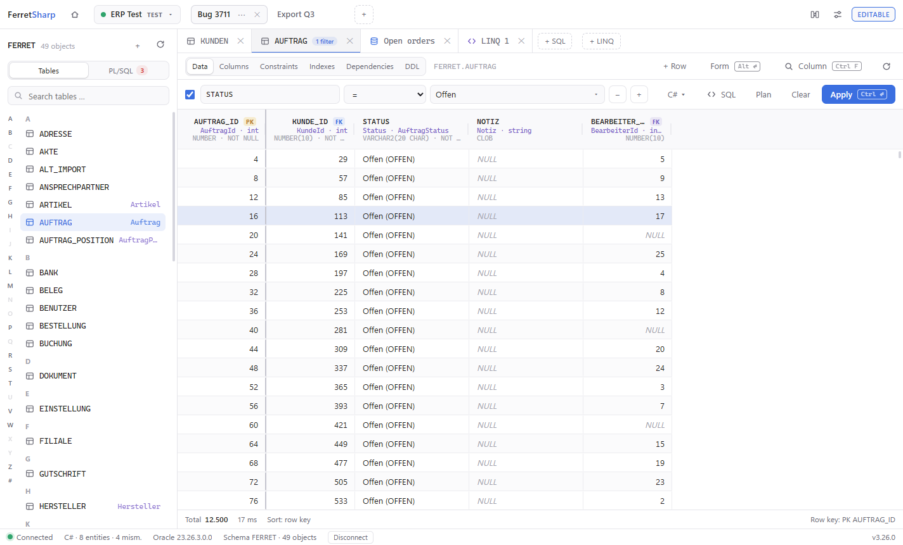
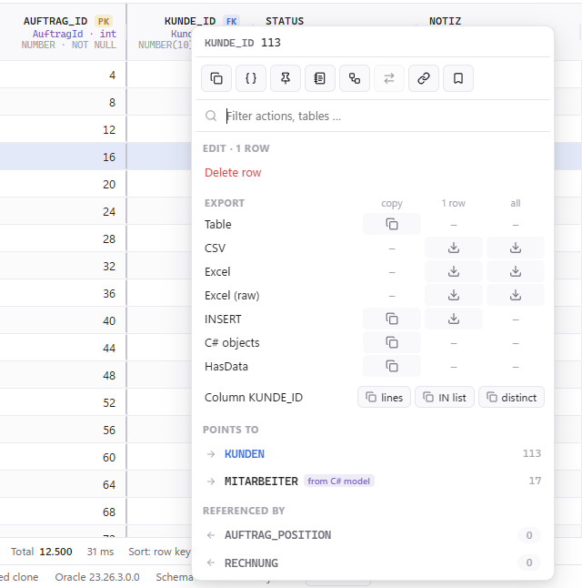
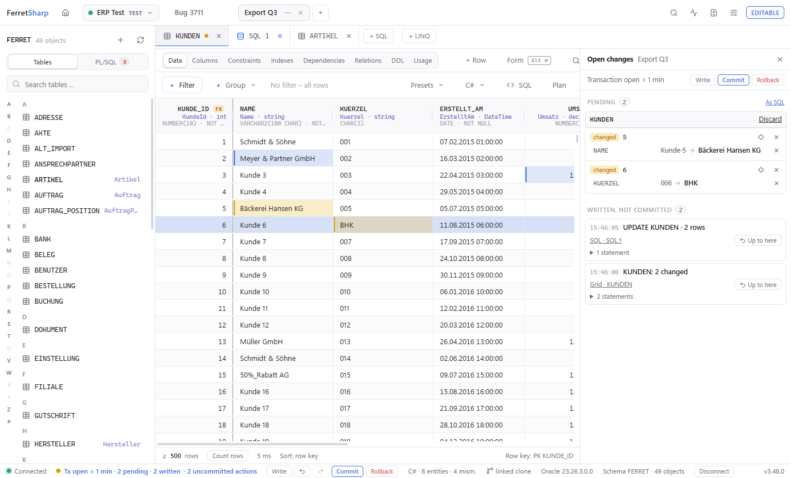
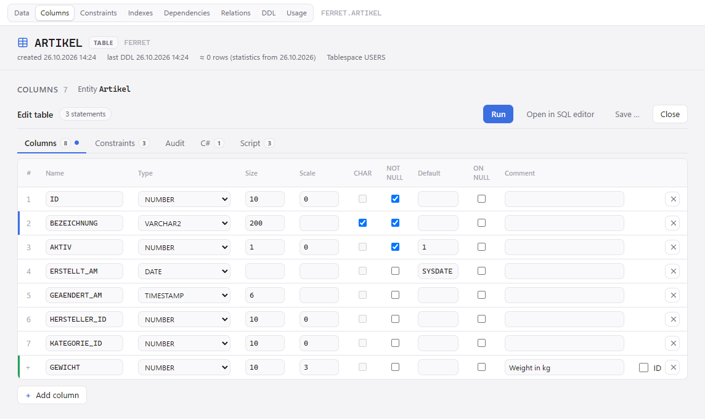
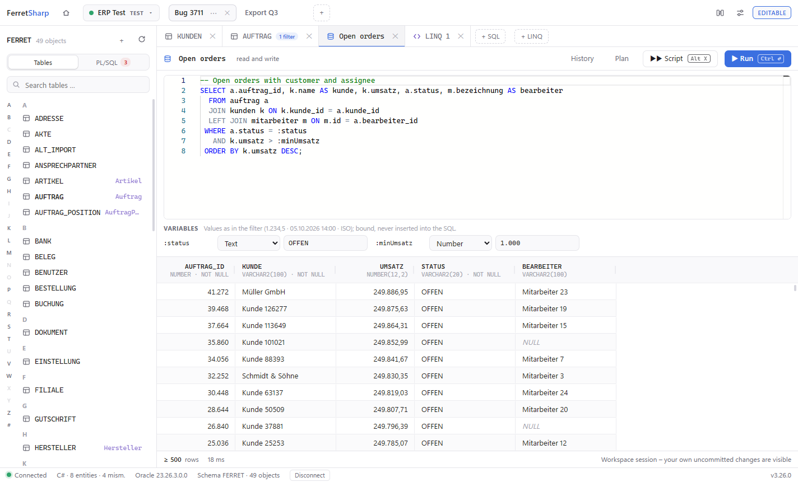
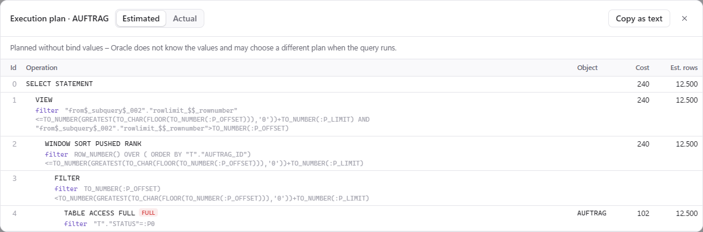
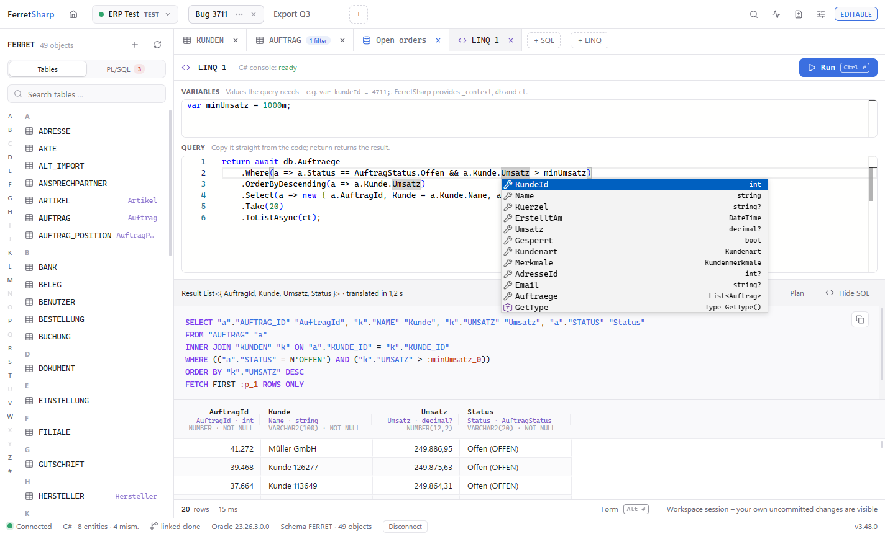

<p align="center">
  
</p>

<h1 align="center">FerretSharp</h1>

<p align="center">
  An Oracle database explorer for .NET developers – with workspaces, foreign-key navigation,<br>
  safe sandbox editing and a bridge to your EF Core model.
</p>

<p align="center">
  <a href="https://github.com/JuliusFo/FerretSharp/actions/workflows/ci.yml"></a>
  <a href="https://github.com/JuliusFo/FerretSharp/actions/workflows/ci.yml?query=branch%3Amain"></a>
  <a href="https://github.com/JuliusFo/FerretSharp/releases/latest"></a>
  
  
  <a href="LICENSE"></a>
</p>

<picture>
  <source media="(prefers-color-scheme: dark)" srcset="docs/images/grid-dark.png">
  
</picture>

> [!NOTE]
> The user interface is in English and German (*Settings › Appearance › Language*; English by default). Code, commits and
> this README are in English; the design notes in `docs/` are German.

## Why

General-purpose database tools know your schema, but not your application. FerretSharp is built around the way a .NET
developer works with an Oracle database day to day:

- **Workspaces** per connection – "Bug 3711", "Export Q3" – each with its own tabs, filters and its **own database session**,
  so two workspaces can look at (and later edit) the same table independently.
- **Follow the data**: jump from a row to the rows it references or that reference it – also along relationships that
  exist only in your EF Core model, without a foreign-key constraint.
- **Edit without fear**: every change runs in an explicit transaction you commit or roll back; production connections are
  read-only by default, enforced by Oracle itself.
- **Speak C#**: entity and property names next to tables and columns, enum members instead of magic numbers, and a LINQ
  console that shows the SQL your code really sends.

## Features

### Browse

- Several connections open at once, one shown: switch from DEV to PROD and back (<kbd>Alt</kbd>+<kbd>O</kbd>) without
  disconnecting – tabs, grids and open transactions stay as they were.
- **Connection groups** to rename, merge, order and fold – drag a connection into another group – and a shortcut of your
  own per connection. A connection the VPN dropped can come back by itself (a setting, off by default): only when no
  uncommitted work would be lost, with pauses between the attempts and never after a refused login.
- Explorer with letter index and search; tables, views, materialized views and objects reachable through synonyms –
  views on request in a section of their own. **Right-click an object** (or the head of its tab) to open it in a view,
  as `SELECT *` in the SQL editor, as its DbSet in the LINQ console, in the designer or on another connection, and to
  copy its name, `OWNER.NAME`, entity or link. A tab can be duplicated with its filters or shown in the explorer.
- Drag the explorer wider or narrower (for every connection) and the SQL and LINQ editors taller or lower (each tab its
  own height) – kept after a restart; a double click on the edge goes back to the default.
- Drag tabs into the order you like; many tabs in one row that scrolls sideways or in several rows (*Settings ›
  Appearance*).
- **Quick open and command palette**: one box at the top of the window – type a name to open a table, view or PL/SQL
  (also by its C# entity name), or ">" to find an action with its shortcut.
- Fast grid for large tables (blocks of 500 rows, server-side sorting, deterministic paging), `NULL` shown as such,
  exact numbers beyond `decimal`, LOB previews, pinned columns, column search (Ctrl+F). The row selection follows the
  keyboard as in the Windows Explorer: Shift+↑/↓, Ctrl+A, Space.
- A table opens on the view of your choice – the data or one of the detail views – and, if you like, without rows:
  set the filters first, then load (*Settings › Data view*).
- Composable filters in the style of TablePlus – column, operator, value – translated into bound SQL; see the generated
  statement (the grid's own or a short `SELECT t.*`) and its execution plan at any time. Combine rows with **OR** and **NOT** groups (NOT treats NULL as C# does,
  so the grid and a LINQ `Where` keep the same rows).
- **SQL condition**: filter a table tab by a condition you write, as in the WHERE field of SQL Developer –
  `ID IN (SELECT …)` on other tables, nested as deep as you like – with completion of the columns and tables, the
  conditions last applied to the table, and the filter bar's filter as a start. The tab stays a table tab: edit, jump
  along foreign keys, count and export as usual. A new tab can start with it (*Settings › Data view*).
- **Filter presets**: save the filter rows of a table, and its sort order, under a name ("Open orders") – a preset
  belongs to the table name, so it works on Dev, Test and Prod alike.
- **Links to a table view**: "Copy link" puts a link with table, filters, sort order and view on the clipboard – an https
  address Teams and tickets make clickable, never SQL. A click opens the table in FerretSharp after asking, on the
  connection that fits or one you choose.
- Names beside foreign keys: mark a display column per table (`KUNDEN.NAME`) and every reference to it reads
  `4711 · PetersPizza`; a name can join several columns (`Müller - Hans`) and follow one more foreign key; a value
  without a referenced row says "not found". The same in the results of the SQL editor and the LINQ console, for
  columns read from a table. The display columns live in one file you
  can share with your team through your repository.
- Object details per table: columns, constraints, indexes (with a hint for unindexed foreign keys), dependencies,
  synonyms, DDL – with *Without owner* the DDL and its GRANT statements leave the object's own schema out, to run them
  under another owner.
- **Synonyms**: every table, view and PL/SQL unit lists the private and public synonyms on it – create one (private in
  the schema or public) or drop one, after the confirmation every schema change gets. "Synonyms of the schema" in the
  command palette lists the schema's private synonyms with their targets and marks those leading nowhere, to clean up.
- **Privileges**: every table, view and PL/SQL unit lists the object privileges on it – who has which, on which columns,
  granted by whom and whether with grant option. Grant one (to a user, a role or PUBLIC, on the whole object or on columns,
  optionally with a synonym in the user's schema) or revoke one; before a revoke it says what goes along (all columns, what was passed on). The DDL view adds the GRANT
  statements. "Privileges in the schema" in the command palette lists them for all objects, by grantee – and the objects
  a user has no privilege on yet, to grant it right there.
- PL/SQL to look at: packages, procedures, functions and triggers with their source (read-only, coloured, compile
  errors marked), parameters per subprogram and overload, compile errors and dependencies – and a search through all
  PL/SQL of the schema. Nothing is run or compiled.
- Form view for wide tables: the focused row beside the grid, one field per column (searchable, empty ones hidden on
  request, editable like the grid); select several rows and compare them side by side with the differences marked
  (<kbd>Alt</kbd>+<kbd>Enter</kbd>). The same for the results of the SQL editor and the LINQ console.
- Copy rows as table, `INSERT` statements or C# object initializers; save as **Excel file**, CSV or SQL script. The Excel
  file has real numbers, dates and true/false (text stays text, nothing runs as a formula), a frozen header with a filter,
  and the labels and values of the grid – C# names, enum members, display columns. Save the selected rows or **all rows
  of the filter**: those are read in the background, with a cancel button in the status bar.
- Copy the values of a column, one per line or as an `IN` list of Oracle literals – from the selected rows or from all
  rows of the filter.
- **Mark cells and whole columns** – drag across the grid (it scrolls on at the edge), Shift+click, Ctrl+click a header –
  and copy them as shown, as a table or as an `IN` list; rows not loaded are read in the background, with cancel.
- Sort the results of the SQL editor and the LINQ console by a click on a header.
- **Relationship diagram**: the "Relations" view of a table – parents left, children right, one or two levels, "+n"
  handles to go further, kinds of relationship to switch off, zoom, copy as Mermaid for a ticket.
- **Every way between two tables**: "Path to …" lists each chain of relationships to another table, shortest first and
  without a limit, in a diagram of all of them; leave out tables every way passes, and turn a way into a query. Drag the
  list's right edge to make it wider or narrower.
- **Build a query in the diagram**: click the relationships to its parents (and to children, of which one row is
  chosen by condition and order), tick columns, add conditions – and get LINQ in the style of query extensions (an
  expression per value, LinqKit, a DTO or your own mapping lines), the SQL with the right joins, a preview of the rows
  or a view. LINQ and SQL find the same rows; the LINQ console runs it with its parameters. Drag the panel's left
  edge to make it wider or narrower.
- **Record diagram**: marked rows with their parents and children over up to four levels, read relationship by
  relationship; a click opens a row filtered, marked rows go to another connection (below).
- **Audit tables read like their base table**: its relationships, C# names and enums, the cells a version changed
  against the one before tinted, inserted and deleted rows marked.

<table>
  <tr>
    <td width="50%">
      <picture>
        <source media="(prefers-color-scheme: dark)" srcset="docs/images/fk-navigation-dark.png">
        
      </picture>
    </td>
    <td width="50%">
      <b>Foreign-key navigation</b><br><br>
      Right-click a cell: jump to the referenced row, or to the rows that reference it – with counts, loaded lazily.
      Each jump opens a new tab with the filter already applied; <kbd>Alt</kbd>+<kbd>←</kbd> takes you back.
      Relationships that exist only as navigations in your DbContext are marked "from C# model". The same works in the
      results of the SQL editor and the LINQ console, for columns read from a table. In the "Constraints" view, "Create
      constraint" turns such a relationship into a real foreign key: the table designer opens with it filled in.
    </td>
  </tr>
</table>

### Edit safely

<picture>
  <source media="(prefers-color-scheme: dark)" srcset="docs/images/changes-dark.png">
  
</picture>

- **Sandbox editing**: changes are *pending* (local), then *written* (DML executed in the workspace's transaction,
  rows locked), then *committed* – each state visible in the grid.
- **Undo and redo** across the whole workspace: grid writes and statements from the SQL editor or the LINQ console share
  one history – take back the last one or everything up to an action, and apply it again. Pending edits have their own
  <kbd>Ctrl</kbd>+<kbd>Z</kbd> / <kbd>Ctrl</kbd>+<kbd>Y</kbd> in the grid.
- **Open changes** beside the tabs: everything the workspace has not committed – pending edits per tab, written actions
  with their SQL, what was taken back – one click from the counts in the status bar.
- **Data diff**: set a start point for a workspace and later see which rows of the chosen tables are new, changed or
  deleted since – whoever changed them (your app, a job, a colleague). Oracle compares the committed state with the
  state at the start (flashback query with `MINUS`), so only the rows that differ come over the line; changed cells
  show their value at the start. Start, compare and discard from the workspace's menu, add a table with its filter
  from the tab menu (*Compare this tab*). Reaches back as far as the database's undo does; tables of other owners need
  the right `FLASHBACK`. The start point can also lie at a time you choose (*Start comparison from…*), and ticked rows
  are set back to it as pending changes of the table's tab – a deleted row inserted again, a changed one with its old
  values, a new one deleted – written the usual way, one <kbd>Ctrl</kbd>+<kbd>Z</kbd> takes them back.
- **Time travel**: *Time travel…* in a table tab's menu shows the table as it was at a time you choose (quick choices
  5, 15, 60 minutes ago), with the tab's filter, read only, in a tab of its own – filter, sort, export, the form and FK
  jumps stay at that point. Reads committed data on a session of its own; the dialog says how far the database's undo
  reaches where the right on `V$UNDOSTAT` is there.
- Lock conflicts are detected after a short wait (`SELECT … FOR UPDATE WAIT n`) and shown with the blocking session.
- Optimistic concurrency check on the changed columns; insert and delete rows; edit CLOBs and BLOBs in a dialog
  (text in the code editor with line wrap, JSON/XML coloring and JSON indenting).
- **Change primary keys** of existing rows like any other value. Before writing, FerretSharp counts the rows that still
  point to the old key – along constraints and relationships without one (manual, by convention, from the C# model) –
  and asks first if there are any; behind a constraint Oracle refuses the change, nothing is changed along.
- **One value for many cells**: type it into one of the marked cells and press <kbd>Ctrl</kbd>+<kbd>Enter</kbd>, or
  paste a copied value with <kbd>Ctrl</kbd>+<kbd>V</kbd> – into the marked cells, the selected rows or just the focused
  cell, no double click needed (a cell copied with <kbd>Ctrl</kbd>+<kbd>C</kbd> pastes back whole, line breaks and
  NULL included); <kbd>Del</kbd> sets marked cells to NULL, <kbd>Ctrl</kbd>+<kbd>D</kbd> fills them down –
  checked per column, pending like any edit, and one step for <kbd>Ctrl</kbd>+<kbd>Z</kbd>.
- **Read-only connections** (default for production) run in `SET TRANSACTION READ ONLY` – Oracle rejects DML. Unlock a
  single workspace on purpose by typing the connection's name.
- **Copy rows to another connection**: the marked rows with their parents and the children you choose into a workspace
  of another connection – checked against its tables first, existing rows skipped, updated or the copy stopped, previewed
  as a table or a diagram, written as one action of its transaction (undo, commit as usual).

<table>
  <tr>
    <td width="50%">
      <picture>
        <source media="(prefers-color-scheme: dark)" srcset="docs/images/designer-dark.png">
        
      </picture>
    </td>
    <td width="50%">
      <b>Table designer</b><br><br>
      Change the columns, keys, checks and foreign keys of a table in tabs, add indexes (each column ascending or
      descending) or create a new table. Choose the tablespace of a new table, of a new index and of the indexes new keys
      and foreign keys bring along – suggested from where the table's or schema's others lie. Rename
      existing constraints (a key takes its index along), give a check a new condition – added before the old one goes –
      or a foreign key another delete rule. A new foreign key finds its table in a searchable list (also by C# name, each
      table with its primary key) and suggests it from the column's name or a relationship of your C# model. You see the DDL before it runs – and the property and configuration lines
      for your entity – and what Oracle would refuse with the data at hand is reported up front. Run, Save and Close stay
      in view at the top, and a locked workspace shows as a bar across the designer.<br><br>
      <b>Audit tables</b> and their trigger come from a template file (your company's pattern, or a built-in one) and
      follow the table's changes; a trigger is switched on only once it compiles. Each connection group – or a single
      connection – can have its own template.
    </td>
  </tr>
</table>

### SQL

<picture>
  <source media="(prefers-color-scheme: dark)" srcset="docs/images/sql-editor-dark.png">
  
</picture>

- SQL editor (Monaco) per workspace: <kbd>Ctrl</kbd>+<kbd>Enter</kbd> runs the statement at the cursor (statements end
  at `;` or a line with only `/`),
  <kbd>Alt</kbd>+<kbd>X</kbd> the whole script, with progress and cancel; queries everywhere, `INSERT`/`UPDATE`/`DELETE`/
  `MERGE` only in writable workspaces, inside their transaction (and part of its undo history).
- **What is it waiting for?** A statement that runs longer says when it waits for a lock – on which table, held by whom
  ("your workspace “Bug 3711”", with a button to go there, or another session with user, machine and program) – and shows
  long operations (full scans, sorts) as a progress bar with Oracle's estimate of the time left. Needs read access to
  `V$SESSION` and `V$SESSION_LONGOPS`.
- DDL (`CREATE`, `ALTER`, `DROP`, `COMMENT`, `GRANT` …) in writable workspaces, outside any transaction and after a
  confirmation; the explorer and open tabs follow the new schema. Triggers are switched on only once they compile,
  compile errors are marked in the editor.
- Bind variables (`:kundeId`) become typed input fields – values are bound, never pasted into the SQL.
- Completion for tables, views, synonyms and columns (with their C# names), history per connection, export of results.
- **SQL scripts:** save a window, a selection (also from the editor's right-click menu) or a history entry as a `.sql`
  file with a description and typed parameters in its head – in your personal folder, one per connection group or a general one (e.g. a shared
  repository). The explorer lists them as a tree (*Scripts*); a click opens one in a new tab without running it, and the
  panel beside the history inserts one at the cursor. A tab opened from a script saves only when asked and reloads when
  the file changes on disk (format: `docs/sql-scripts.md`).
- **Keep results:** *Keep result* above a query's result keeps it, with its rows as they were read, when the next
  statement runs – up to ten per tab, side by side in the bar above the grid, each named by its table and time (a double
  click renames it). A kept result never reads again: it sorts, copies and exports the rows it holds. Every result shows
  the statement and the variables it ran with, and *To the editor* selects that statement in the script or inserts it.
  *Load all rows* reads the rest of a result (up to 10,000 rows) before you keep it.
- Results know where their columns come from: C# names, enum members, names beside foreign keys and foreign-key jumps
  as in a table – also with the quoted aliases EF Core writes and through synonyms. Columns of a result can be pinned;
  the tab keeps them for every result it shows.
- Execution plans: estimated (`EXPLAIN PLAN`) or actual, with row counts from the real execution and misestimates flagged.

<picture>
  <source media="(prefers-color-scheme: dark)" srcset="docs/images/explain-plan-dark.png">
  
</picture>

### Schema comparison

- Compare any number of connections or schemas – Dev, Test, Prod, customer databases – in one matrix: tables, views,
  columns (type, length, NULL, default, identity), keys, foreign keys, checks and indexes. Sides with the same definition
  share a colour; names Oracle generated (`SYS_C…`) are matched by content.
- Views and materialized views compare by their query – spaces, comments, letter case and the own schema do not count –
  with `WITH READ ONLY`/`CHECK OPTION` or their refresh options, and by status (an invalid view is a difference). A click
  on the definition shows the text of each variant.
- "Forgot the ALTER on Test?": a DDL proposal aligns one side with another for the objects you tick in the matrix – views
  created or replaced in the order they build on each other, invalid ones compiled; drops, renames and recreating a
  materialized view only as commented-out hints – that runs on the target connection right from the dialog (with the usual
  confirmation, also on a connection in the background) or opens in its SQL editor. Comparisons can be saved and copied as
  Markdown; the search and the opened rows stay when you come back.
- Single columns to another database: pick them in the "Columns" view (or mark their headers in the grid) and right-click
  – `ALTER TABLE … ADD` with their comments and the foreign keys made only of them, to copy or to open in the SQL
  editor of another connection.

### .NET and EF Core

<picture>
  <source media="(prefers-color-scheme: dark)" srcset="docs/images/linq-console-dark.png">
  
</picture>

Link a connection to your EF Core project (EF Core 8 or later) and FerretSharp loads the compiled model in a separate
process – using your project's runtime, provider and value converters. The model is cached until the build output
changes, and a new build is picked up automatically:

- **Names**: entity and property names next to tables and columns (or in front of them), searchable everywhere.
- **Values**: enum members and converted values (`Gewerbe (2)`, `true` for `'J'`), also as dropdowns in filters and
  when editing – flags enums as a list of check boxes – including `[Display]` names from your resources.
- **Report**: one page shows how your model and the database fit – tables without entity, columns without property,
  entities and properties without counterpart, columns whose type, NULL, length or precision does not fit
  (`DateTimeOffset` on `DATE`, `HasMaxLength(200)` on `VARCHAR2(100)`, each with what will fail), relationships only in
  the model or only in the database, and columns no code uses. Tiles with the counts, sections that fold, and what to do
  about each entry: create the entity or the constraint, copy the property or navigation code, or mark a table as meant
  to have no entity – in a file you can share through your repository (audit tables are left out by themselves).
  Computed from what is loaded: no query of its own.
- **Relationships**: navigations without a foreign-key constraint become navigable relationships.
- **LINQ console**: paste a query from your code – unknown variables become suggested declarations, your context and
  cancellation token are recognized. FerretSharp shows the SQL EF Core would send and runs it in the workspace's session,
  so your uncommitted changes are visible. Completion knows your DbSets, properties, enums and the LINQ/EF methods.
- **Code generation**: the grid's filters as a LINQ `Where`, rows as C# objects or `HasData` seed data – and, DB-first,
  the entity class and its `IEntityTypeConfiguration` for a table the model does not know yet (or the property and
  configuration line for a new column), in the style of your project.
- **App statements**: attach to your app while it runs (debugging in Visual Studio, `dotnet run`) – no code change – and
  see every statement it sends through EF Core, grouped by origin (LINQ, lazy loading, raw SQL, `SaveChanges` …), the
  most frequent and most expensive ones, and N+1 patterns. Look a statement up in V$SQL of the app's connection with its
  plan, or open it in the SQL editor. Local apps of your own user only, EF Core 7 or later for the origin.
- **Server load**: how busy the database server is – host CPU, active sessions against the CPUs, what the sessions
  wait for, a chart of up to the last hour – and its top statements by CPU, time, executions or reads, either for the time
  you watch or since each was loaded (like SQL Developer’s reports), with plan, Excel export and the sessions running
  right now. Only views outside the Diagnostics and Tuning Pack; needs `SELECT_CATALOG_ROLE` or grants on the V$ views.
  A statement's details open in a dialog with folding parts (SQL, origin in code, plan) and step through the list. With a
  linked C# project they name the methods of your solution that may send it – guessed from its tables and the columns it
  filters by, ranked, with a meter of how much of the statement each covers – and a click opens the line in Visual Studio.
  Projects of the solution that are not built are marked there, as their methods are missing, with *Build projects* at hand.
- **Usage in the code**: per column, the methods of your solution that read or write its property or query the table,
  read from the compiled code – a click opens the line in Visual Studio. Properties no code uses are marked, and the
  designer warns before dropping a column the code still uses. Uses open in your *work clone* of the connection group.
  Columns your code filters on (`Where`, `Any`, `First…`) without an index that starts with them are marked.
  Projects not built are named; *Build projects* builds the solution and shows how many of its projects are done.
- **Model file**: can't build the project (packages from a private feed)? A colleague exports the model as a file, and
  you link that instead – names, enums and relationships without a build and without running the project's code.

## Getting started

**Requirements**

- Windows 10 or 11, x64 (the WebView2 runtime is part of Windows).
- Oracle Database 19c or later (12.2 should work). Plain TCP connections (host/port with service name or SID, or a TNS
  alias); no Oracle client installation needed.
- Optional, for the .NET features: an EF Core 8+ project that builds, and the .NET SDK.

**Install**

1. Download `FerretSharp-win-Setup.exe` from the [latest release](https://github.com/JuliusFo/FerretSharp/releases/latest)
   and run it – it installs FerretSharp for your user (no admin rights) with shortcuts on the desktop and in the start
   menu. The installer is not signed, so Windows SmartScreen warns once: *More info › Run anyway*.
2. From then on FerretSharp checks for a new version at start and every 4 hours while it runs (*Settings › Updates*:
   hourly, daily, only at start, or off) and shows it in the status bar; *Download* fetches it, *Restart now* installs it. Nothing is downloaded or installed without your
   click. The update dialog loads the images of the release notes from this repository on GitHub.

Without installing: `FerretSharp-win-Portable.zip` – unzip anywhere and start `FerretSharp.exe`; it updates itself the
same way.

Coming from the zip of 3.28 or older: run `FerretSharp-win-Setup.exe` once and delete the old folder by hand. Settings,
connections and workspaces stay where they are.

**Bring your connections along:** *Connections › Import…* finds DBeaver and SQL Developer on your computer (or takes a
file: DBeaver's `data-sources.json` or project export `.dbp`, SQL Developer's export, another FerretSharp's export or
`connections.json`). A preview shows each connection with its environment – guessed from the name where the source has
none, and read-only until you pick one –, the user and whether you have it already. Passwords are never imported; you
enter them on the first connect. *⋯ › Export…* (or *Export group…* on a group) passes connections on, without passwords.

Settings and workspaces live in `%APPDATA%\FerretSharp` (uninstalling keeps them); passwords are stored in the Windows
Credential Manager, never in files. On production connections the log holds neither bind values nor literals of a statement and the SQL history no bind values; the workspace
files keep what you work on – SQL text, filter and variable values – like an open document. One FerretSharp runs per data folder: starting it again brings the open window to
the front.

> [!IMPORTANT]
> FerretSharp guards against accidental writes in many places, but the only real guarantee is on the database side – a
> read-only transaction stops neither DDL nor a function with an autonomous transaction that a SELECT calls:
> **for production, use a database user with SELECT grants only.**

## Keyboard shortcuts

The defaults – every one of them can be changed under *Settings › Shortcuts*, which also lists the fixed keys.

| Keys | Action |
|---|---|
| <kbd>Ctrl</kbd>+<kbd>Shift</kbd>+<kbd>O</kbd> | Switch connection |
| <kbd>Alt</kbd>+<kbd>O</kbd> | Back to the previous open connection (it stays connected in the background) |
| <kbd>Ctrl</kbd>+<kbd>Enter</kbd> | Apply filters · run the statement at the cursor (SQL) · run the code (LINQ) |
| <kbd>F5</kbd> | Refresh |
| <kbd>Ctrl</kbd>+<kbd>F</kbd> | Find a column · search in the editor |
| <kbd>Alt</kbd>+<kbd>←</kbd> / <kbd>Alt</kbd>+<kbd>→</kbd> | Back / forward along foreign-key jumps |
| <kbd>Alt</kbd>+<kbd>Enter</kbd> | Form view of the focused row · compare the selected rows |
| <kbd>Alt</kbd>+<kbd>↑</kbd> / <kbd>Alt</kbd>+<kbd>↓</kbd> | Previous / next row in the form |
| <kbd>Ctrl</kbd>+<kbd>Z</kbd> / <kbd>Ctrl</kbd>+<kbd>Y</kbd> | Undo / redo a pending edit in the grid |
| <kbd>Ctrl</kbd>+<kbd>S</kbd> | Write pending changes (no commit) |
| <kbd>Ctrl</kbd>+<kbd>Shift</kbd>+<kbd>Enter</kbd> | Commit |
| <kbd>Ctrl</kbd>+<kbd>Shift</kbd>+<kbd>U</kbd> | Show or hide the open changes |
| <kbd>Ctrl</kbd>+<kbd>Shift</kbd>+<kbd>Q</kbd> / <kbd>Ctrl</kbd>+<kbd>Shift</kbd>+<kbd>L</kbd> | New SQL editor / new LINQ console |
| <kbd>Alt</kbd>+<kbd>X</kbd> | Run the whole SQL script |

## Building from source

You need the .NET 10 SDK (pinned in `global.json`) and, for the integration tests, Docker.

```shell
dotnet build
dotnet test
dotnet run --project src/FerretSharp.App
```

- Integration tests start Oracle Free in Docker ([Testcontainers](https://dotnet.testcontainers.org/)) and are skipped
  when Docker is not available.
- `tools/coverage/Get-Coverage.ps1` measures the test coverage like CI does and writes an HTML report to
  `artifacts/coverage/report`. The coverage badge counts unit and integration tests over `FerretSharp.Core` and
  `FerretSharp.UI` without generated code and Razor markup (`tests/coverage.config`); the report of each CI run is
  attached to it as an artifact.
- `tools/linux/Test-Linux.ps1` builds and runs the unit tests under Linux in Docker, like the first CI job, on the
  working tree including uncommitted changes – CI tests on Linux first, so platform differences show up before a push.
- `tools/sample-db/New-SampleDb.ps1` creates a local sample database with the schema used in the screenshots;
  `samples/` contains a matching EF Core project.
- A release build is a self-contained folder:
  `dotnet publish src/FerretSharp.App -c Release -r win-x64 --self-contained -o <folder>`.

**Tech stack:** .NET 10, WPF host with Blazor Hybrid (WebView2), [AG Grid Community](https://www.ag-grid.com/),
[Monaco Editor](https://microsoft.github.io/monaco-editor/), Oracle.ManagedDataAccess.Core, Roslyn for the LINQ console,
[SpreadCheetah](https://github.com/sveinungf/spreadcheetah) for the Excel export, Velopack for install and updates.

**Design notes:** [CHANGELOG.md](CHANGELOG.md) lists every release; architecture decisions are in
[docs/decisions](docs/decisions), ideas in [docs/backlog.md](docs/backlog.md) (both in German).

## License

[MIT](LICENSE). AG Grid Community and Monaco Editor are included under their MIT licenses, the icons come from
[Lucide](https://lucide.dev) under the ISC license (see `src/FerretSharp.UI/wwwroot/lib`).
