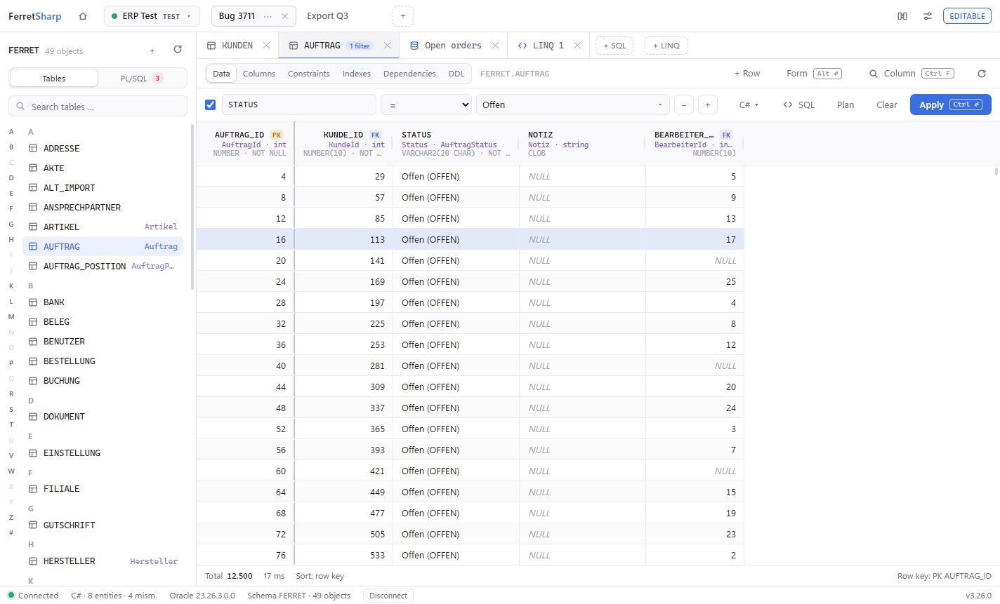
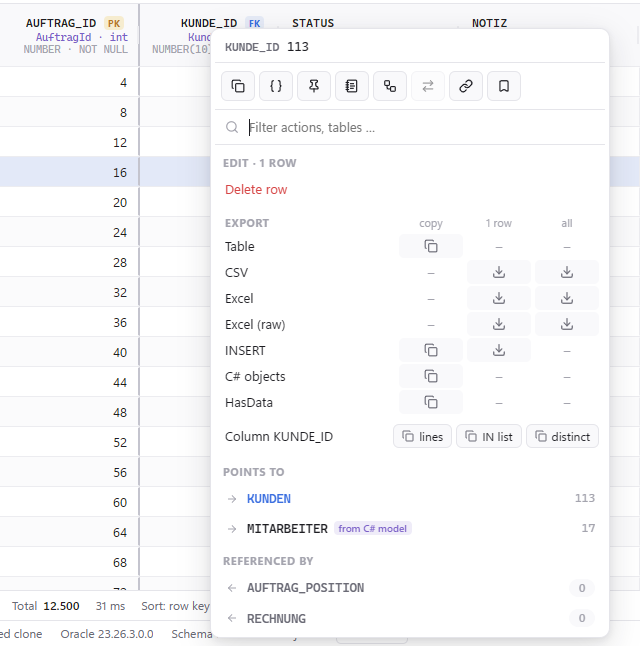
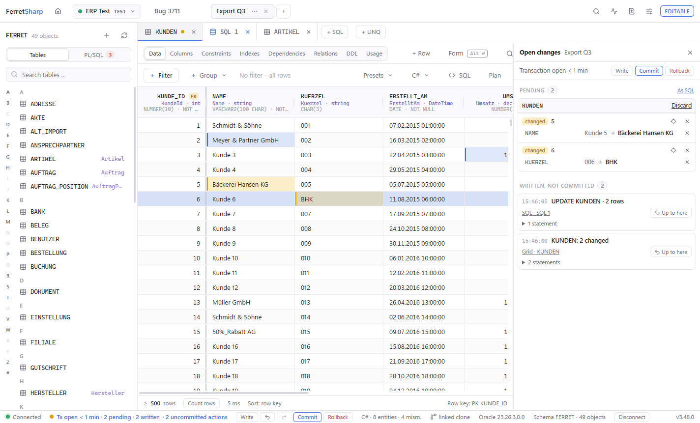
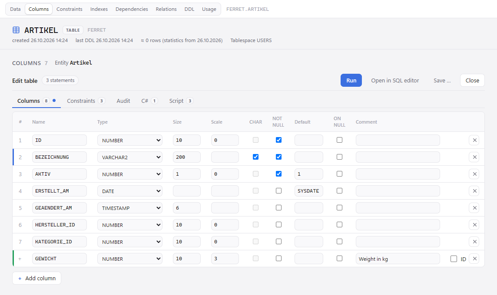
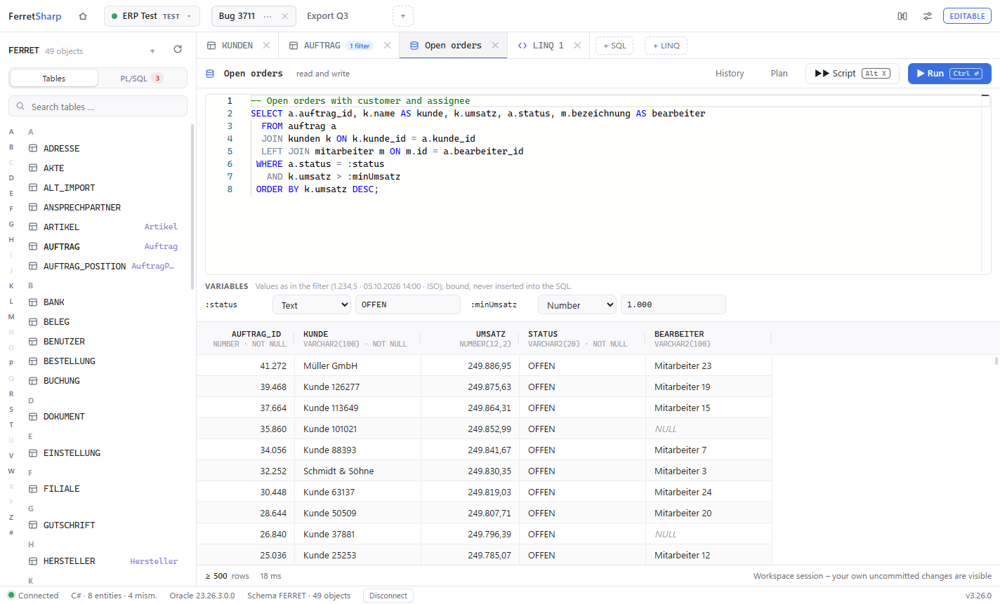
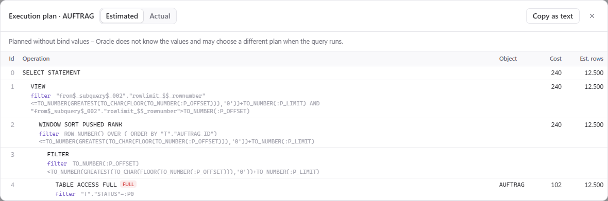
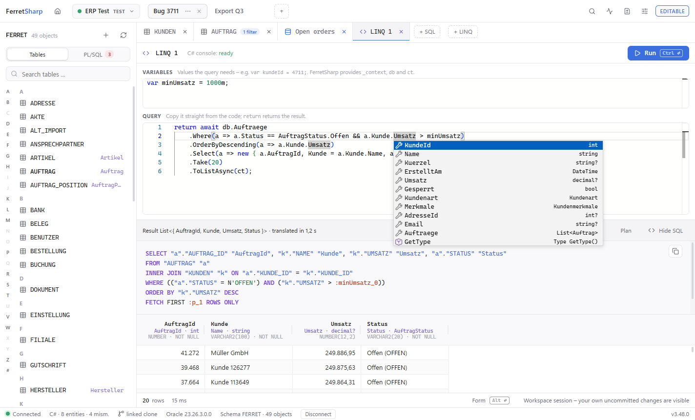

<p align="center">
  
</p>

<h1 align="center">FerretSharp</h1>

<p align="center">
  An Oracle database explorer for .NET developers – with workspaces, foreign-key navigation,<br>
  safe sandbox editing and a bridge to your EF Core model.
</p>

<p align="center">
  <a href="https://github.com/JuliusFo/FerretSharp/actions/workflows/ci.yml"></a>
  <a href="https://github.com/JuliusFo/FerretSharp/actions/workflows/ci.yml?query=branch%3Amain"></a>
  <a href="https://github.com/JuliusFo/FerretSharp/releases/latest"></a>
  
  
  <a href="LICENSE"></a>
</p>

<picture>
  <source media="(prefers-color-scheme: dark)" srcset="docs/images/grid-dark.png">
  
</picture>

> [!NOTE]
> The user interface is in English and German (*Settings › General › Language*; English by default). Code, commits and
> this README are in English; the design notes in `docs/` are German.

## Why

General-purpose database tools know your schema, but not your application. FerretSharp is built around the way a .NET
developer works with an Oracle database day to day:

- **Workspaces** per connection – "Bug 3711", "Export Q3" – each with its own tabs, filters and its **own database session**,
  so two workspaces can look at (and later edit) the same table independently.
- **Follow the data**: jump from a row to the rows it references or that reference it – also along relationships that
  exist only in your EF Core model, without a foreign-key constraint.
- **Edit without fear**: every change runs in an explicit transaction you commit or roll back; production connections are
  read-only by default, enforced by Oracle itself.
- **Speak C#**: entity and property names next to tables and columns, enum members instead of magic numbers, and a LINQ
  console that shows the SQL your code really sends.

## Features

### Browse

- Several connections open at once, one shown: switch from DEV to PROD and back (<kbd>Alt</kbd>+<kbd>O</kbd>) without
  disconnecting – tabs, grids and open transactions stay as they were.
- Explorer with letter index and search; tables, views, materialized views and objects reachable through synonyms.
- Fast grid for large tables (blocks of 500 rows, server-side sorting, deterministic paging), `NULL` shown as such,
  exact numbers beyond `decimal`, LOB previews, pinned columns, column search (Ctrl+F).
- Composable filters in the style of TablePlus – column, operator, value – translated into bound SQL; see the generated
  statement and its execution plan at any time.
- Names beside foreign keys: mark a display column per table (`KUNDEN.NAME`) and every reference to it reads
  `4711 · PetersPizza`; a value without a referenced row says "not found". The display columns live in one file you
  can share with your team through your repository.
- Object details per table: columns, constraints, indexes (with a hint for unindexed foreign keys), dependencies, DDL.
- PL/SQL to look at: packages, procedures, functions and triggers with their source (read-only, coloured, compile
  errors marked), parameters per subprogram and overload, compile errors and dependencies – and a search through all
  PL/SQL of the schema. Nothing is run or compiled.
- Form view for wide tables: the focused row beside the grid, one field per column (searchable, empty ones hidden on
  request, editable like the grid); select several rows and compare them side by side with the differences marked
  (<kbd>Alt</kbd>+<kbd>Enter</kbd>).
- Copy rows as table, `INSERT` statements or C# object initializers; save as CSV or SQL script.

<table>
  <tr>
    <td width="50%">
      <picture>
        <source media="(prefers-color-scheme: dark)" srcset="docs/images/fk-navigation-dark.png">
        
      </picture>
    </td>
    <td width="50%">
      <b>Foreign-key navigation</b><br><br>
      Right-click a cell: jump to the referenced row, or to the rows that reference it – with counts, loaded lazily.
      Each jump opens a new tab with the filter already applied; <kbd>Alt</kbd>+<kbd>←</kbd> takes you back.
      Relationships that exist only as navigations in your DbContext are marked "aus C#-Modell".
    </td>
  </tr>
</table>

### Edit safely

<picture>
  <source media="(prefers-color-scheme: dark)" srcset="docs/images/changes-dark.png">
  
</picture>

- **Sandbox editing**: changes are *pending* (local), then *written* (DML executed in the workspace's transaction,
  rows locked), then *committed* – each state visible in the grid.
- **Undo and redo** across the whole workspace: grid writes and statements from the SQL editor or the LINQ console share
  one history – take back the last one or everything up to an action, and apply it again. Pending edits have their own
  <kbd>Ctrl</kbd>+<kbd>Z</kbd> / <kbd>Ctrl</kbd>+<kbd>Y</kbd> in the grid.
- **Open changes** beside the tabs: everything the workspace has not committed – pending edits per tab, written actions
  with their SQL, what was taken back – one click from the counts in the status bar.
- Lock conflicts are detected after a short wait (`SELECT … FOR UPDATE WAIT n`) and shown with the blocking session.
- Optimistic concurrency check on the changed columns; insert and delete rows; edit CLOBs and BLOBs in a dialog.
- **Read-only connections** (default for production) run in `SET TRANSACTION READ ONLY` – Oracle rejects DML. Unlock a
  single workspace on purpose by typing the connection's name.

<table>
  <tr>
    <td width="50%">
      <picture>
        <source media="(prefers-color-scheme: dark)" srcset="docs/images/designer-dark.png">
        
      </picture>
    </td>
    <td width="50%">
      <b>Table designer</b><br><br>
      Change the columns, keys, checks and foreign keys of a table, add indexes or create a new table. You see the DDL
      before it runs – and the property and configuration lines for your entity – and what Oracle would refuse with
      the data at hand is reported up front.<br><br>
      <b>Audit tables</b> and their trigger come from a template file (your company's pattern, or a built-in one) and
      follow the table's changes; a trigger is switched on only once it compiles.
    </td>
  </tr>
</table>

### SQL

<picture>
  <source media="(prefers-color-scheme: dark)" srcset="docs/images/sql-editor-dark.png">
  
</picture>

- SQL editor (Monaco) per workspace: <kbd>Ctrl</kbd>+<kbd>Enter</kbd> runs the statement at the cursor,
  <kbd>Alt</kbd>+<kbd>X</kbd> the whole script, with progress and cancel; queries everywhere, `INSERT`/`UPDATE`/`DELETE`/
  `MERGE` only in writable workspaces, inside their transaction (and part of its undo history).
- DDL (`CREATE`, `ALTER`, `DROP`, `COMMENT`, `GRANT` …) in writable workspaces, outside any transaction and after a
  confirmation; the explorer and open tabs follow the new schema. Triggers are switched on only once they compile,
  compile errors are marked in the editor.
- Bind variables (`:kundeId`) become typed input fields – values are bound, never pasted into the SQL.
- Completion for tables, views, synonyms and columns (with their C# names), history per connection, export of results.
- Execution plans: estimated (`EXPLAIN PLAN`) or actual, with row counts from the real execution and misestimates flagged.

<picture>
  <source media="(prefers-color-scheme: dark)" srcset="docs/images/explain-plan-dark.png">
  
</picture>

### Schema comparison

- Compare any number of connections or schemas – Dev, Test, Prod, customer databases – in one matrix: tables, views,
  columns (type, length, NULL, default, identity), keys, foreign keys, checks and indexes. Sides with the same definition
  share a colour; names Oracle generated (`SYS_C…`) are matched by content.
- "Forgot the ALTER on Test?": a DDL proposal aligns one side with another – drops and renames only as commented-out
  hints – and opens in the SQL editor of the target connection. Comparisons can be saved and copied as Markdown.

### .NET and EF Core

<picture>
  <source media="(prefers-color-scheme: dark)" srcset="docs/images/linq-console-dark.png">
  
</picture>

Link a connection to your EF Core project (EF Core 8 or later) and FerretSharp loads the compiled model in a separate
process – using your project's runtime, provider and value converters. The model is cached until the build output
changes, and a new build is picked up automatically:

- **Names**: entity and property names next to tables and columns (or in front of them), searchable everywhere.
- **Values**: enum members and converted values (`Gewerbe (2)`, `true` for `'J'`), also as dropdowns in filters and
  when editing – flags enums as a list of check boxes – including `[Display]` names from your resources.
- **Drift**: the model page lists what does not fit the database – missing tables and columns, but also types, NULL,
  lengths and precision (`DateTimeOffset` on `DATE`, `HasMaxLength(200)` on `VARCHAR2(100)`), each with what will fail.
- **Relationships**: navigations without a foreign-key constraint become navigable relationships.
- **LINQ console**: paste a query from your code – unknown variables become suggested declarations, your context and
  cancellation token are recognized. FerretSharp shows the SQL EF Core would send and runs it in the workspace's session,
  so your uncommitted changes are visible. Completion knows your DbSets, properties, enums and the LINQ/EF methods.
- **Code generation**: the grid's filters as a LINQ `Where`, rows as C# objects or `HasData` seed data – and, DB-first,
  the entity class and its `IEntityTypeConfiguration` for a table the model does not know yet (or the property and
  configuration line for a new column), in the style of your project.
- **App statements**: attach to your app while it runs (debugging in Visual Studio, `dotnet run`) – no code change – and
  see every statement it sends through EF Core, grouped by origin (LINQ, lazy loading, raw SQL, `SaveChanges` …), the
  most frequent and most expensive ones, and N+1 patterns. Look a statement up in V$SQL of the app's connection with its
  plan, or open it in the SQL editor. Local apps of your own user only, EF Core 7 or later for the origin.

## Getting started

**Requirements**

- Windows 10 or 11, x64 (the WebView2 runtime is part of Windows).
- Oracle Database 19c or later (12.2 should work). Plain TCP connections (host/port with service name or SID, or a TNS
  alias); no Oracle client installation needed.
- Optional, for the .NET features: an EF Core 8+ project that builds, and the .NET SDK.

**Install**

1. Download `FerretSharp-win-Setup.exe` from the [latest release](https://github.com/JuliusFo/FerretSharp/releases/latest)
   and run it – it installs FerretSharp for your user (no admin rights) with shortcuts on the desktop and in the start
   menu. The installer is not signed, so Windows SmartScreen warns once: *More info › Run anyway*.
2. From then on FerretSharp checks for a new version at start (*Settings › Updates*, can be switched off) and shows it in
   the status bar; *Download* fetches it, *Restart now* installs it. Nothing is downloaded or installed without your
   click.

Without installing: `FerretSharp-win-Portable.zip` – unzip anywhere and start `FerretSharp.exe`; it updates itself the
same way.

Coming from the zip of 3.28 or older: run `FerretSharp-win-Setup.exe` once and delete the old folder by hand. Settings,
connections and workspaces stay where they are.

**Bring your connections along:** *Connections › Import…* finds DBeaver and SQL Developer on your computer (or takes a
file: DBeaver's `data-sources.json` or project export `.dbp`, SQL Developer's export, another FerretSharp's export or
`connections.json`). A preview shows each connection with its environment – guessed from the name where the source has
none, and read-only until you pick one –, the user and whether you have it already. Passwords are never imported; you
enter them on the first connect. *⋯ › Export…* (or *Export group…* on a group) passes connections on, without passwords.

Settings and workspaces live in `%APPDATA%\FerretSharp` (uninstalling keeps them); passwords are stored in the Windows
Credential Manager, never in files. One FerretSharp runs per data folder: starting it again brings the open window to
the front.

> [!IMPORTANT]
> FerretSharp guards against accidental writes in many places, but the only real guarantee is on the database side – a
> read-only transaction stops neither DDL nor a function with an autonomous transaction that a SELECT calls:
> **for production, use a database user with SELECT grants only.**

## Keyboard shortcuts

The defaults – every one of them can be changed under *Settings › Shortcuts*, which also lists the fixed keys.

| Keys | Action |
|---|---|
| <kbd>Ctrl</kbd>+<kbd>Shift</kbd>+<kbd>O</kbd> | Switch connection |
| <kbd>Alt</kbd>+<kbd>O</kbd> | Back to the previous open connection (it stays connected in the background) |
| <kbd>Ctrl</kbd>+<kbd>Enter</kbd> | Apply filters · run the statement at the cursor (SQL) · run the code (LINQ) |
| <kbd>F5</kbd> | Refresh |
| <kbd>Ctrl</kbd>+<kbd>F</kbd> | Find a column · search in the editor |
| <kbd>Alt</kbd>+<kbd>←</kbd> / <kbd>Alt</kbd>+<kbd>→</kbd> | Back / forward along foreign-key jumps |
| <kbd>Alt</kbd>+<kbd>Enter</kbd> | Form view of the focused row · compare the selected rows |
| <kbd>Ctrl</kbd>+<kbd>Z</kbd> / <kbd>Ctrl</kbd>+<kbd>Y</kbd> | Undo / redo a pending edit in the grid |
| <kbd>Ctrl</kbd>+<kbd>S</kbd> | Write pending changes (no commit) |
| <kbd>Ctrl</kbd>+<kbd>Shift</kbd>+<kbd>Enter</kbd> | Commit |
| <kbd>Ctrl</kbd>+<kbd>Shift</kbd>+<kbd>U</kbd> | Show or hide the open changes |
| <kbd>Ctrl</kbd>+<kbd>Shift</kbd>+<kbd>Q</kbd> / <kbd>Ctrl</kbd>+<kbd>Shift</kbd>+<kbd>L</kbd> | New SQL editor / new LINQ console |
| <kbd>Alt</kbd>+<kbd>X</kbd> | Run the whole SQL script |

## Building from source

You need the .NET 10 SDK (pinned in `global.json`) and, for the integration tests, Docker.

```shell
dotnet build
dotnet test
dotnet run --project src/FerretSharp.App
```

- Integration tests start Oracle Free in Docker ([Testcontainers](https://dotnet.testcontainers.org/)) and are skipped
  when Docker is not available.
- `tools/coverage/Get-Coverage.ps1` measures the test coverage like CI does and writes an HTML report to
  `artifacts/coverage/report`. The coverage badge counts unit and integration tests over `FerretSharp.Core` and
  `FerretSharp.UI` without generated code and Razor markup (`tests/coverage.config`); the report of each CI run is
  attached to it as an artifact.
- `tools/sample-db/New-SampleDb.ps1` creates a local sample database with the schema used in the screenshots;
  `samples/` contains a matching EF Core project.
- A release build is a self-contained folder:
  `dotnet publish src/FerretSharp.App -c Release -r win-x64 --self-contained -o <folder>`.

**Tech stack:** .NET 10, WPF host with Blazor Hybrid (WebView2), [AG Grid Community](https://www.ag-grid.com/),
[Monaco Editor](https://microsoft.github.io/monaco-editor/), Oracle.ManagedDataAccess.Core, Roslyn for the LINQ console.

**Design notes:** [CHANGELOG.md](CHANGELOG.md) lists every release; architecture decisions are in
[docs/decisions](docs/decisions), ideas in [docs/backlog.md](docs/backlog.md) (both in German).

## License

[MIT](LICENSE). AG Grid Community and Monaco Editor are included under their MIT licenses
(see `src/FerretSharp.UI/wwwroot/lib`).
