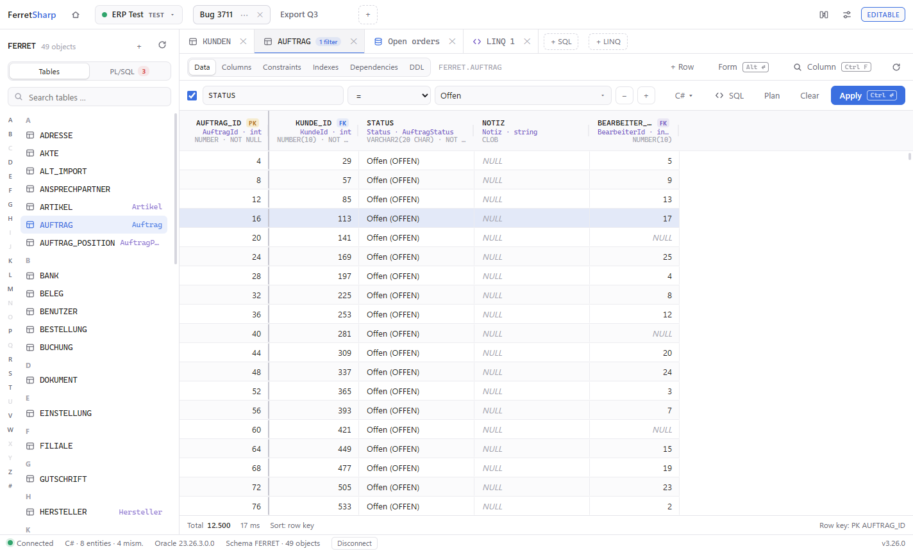
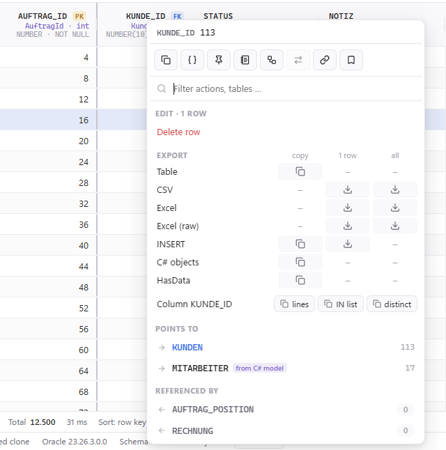
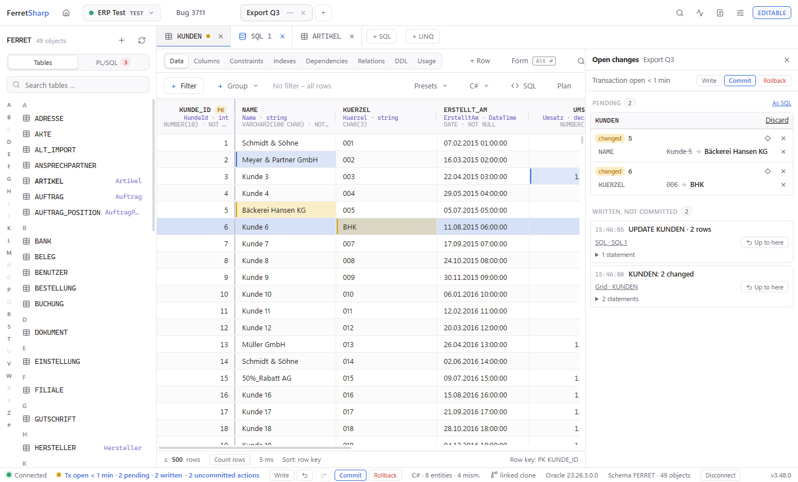
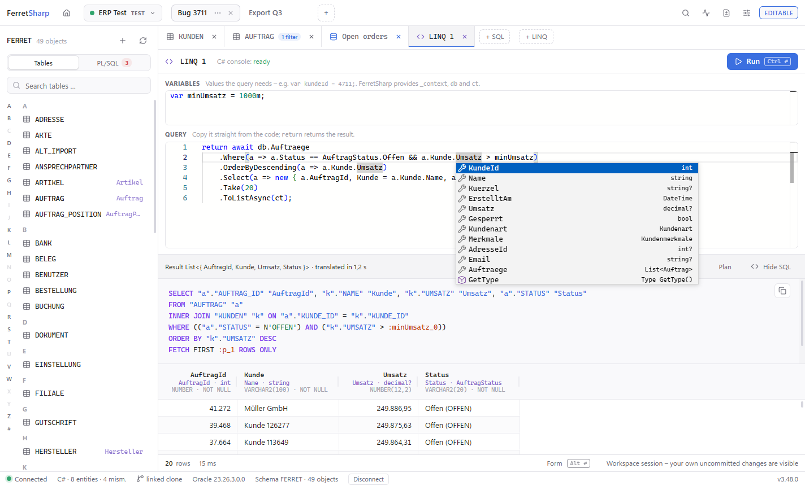
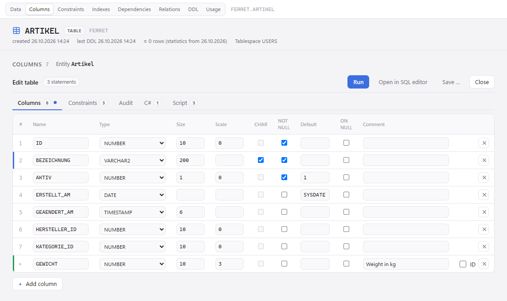
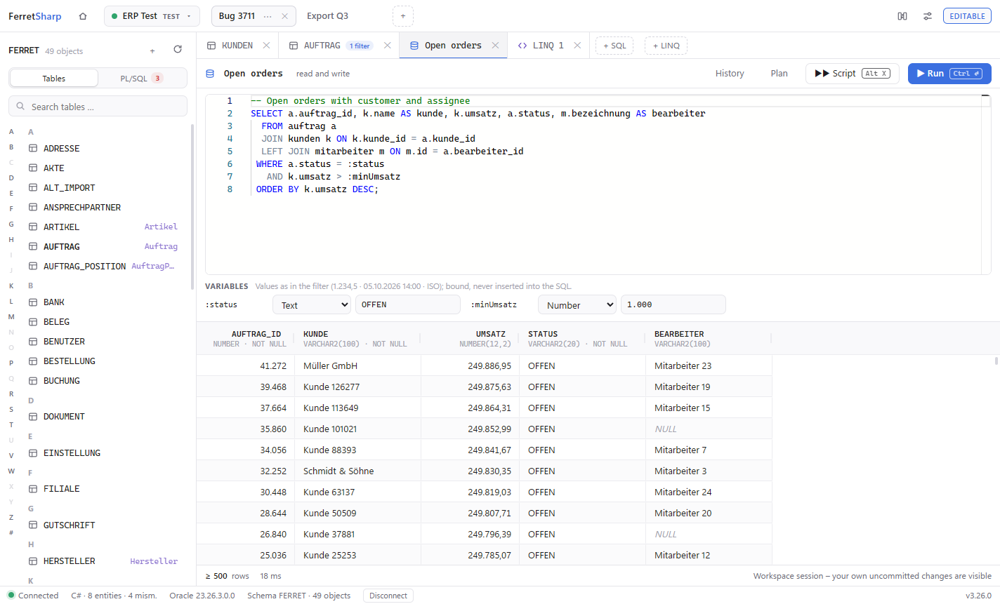
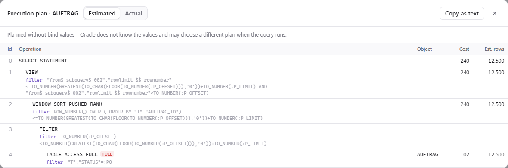

<p align="center">
  
</p>

<h1 align="center">FerretSharp</h1>

<p align="center">
  An Oracle database explorer for .NET developers – with workspaces, foreign-key navigation,<br>
  safe sandbox editing and a bridge to your EF Core model.
</p>

<p align="center">
  <a href="https://github.com/JuliusFo/FerretSharp/actions/workflows/ci.yml"></a>
  <a href="https://github.com/JuliusFo/FerretSharp/actions/workflows/ci.yml?query=branch%3Amain"></a>
  <a href="https://github.com/JuliusFo/FerretSharp/releases/latest"></a>
  
  
  <a href="LICENSE"></a>
</p>

<p align="center">
  <a href="https://github.com/JuliusFo/FerretSharp/releases/latest"><b>Download</b></a> ·
  <a href="#getting-started">Getting started</a> ·
  <a href="docs/features.md"><b>All features</b></a> ·
  <a href="CHANGELOG.md">Changelog</a>
</p>

<picture>
  <source media="(prefers-color-scheme: dark)" srcset="docs/images/grid-dark.png">
  
</picture>

> [!NOTE]
> The user interface is in English and German (*Settings › Appearance › Language*; English by default). Code, commits,
> this README and the [feature list](docs/features.md) are in English; the design notes in `docs/` are German.

## Why

General-purpose database tools know your schema, but not your application. FerretSharp is built around the way a .NET
developer works with an Oracle database day to day:

- **Workspaces** per connection – "Bug 3711", "Export Q3" – each with its own tabs, filters and its **own database session**,
  so two workspaces can look at (and later edit) the same table independently.
- **Follow the data**: jump from a row to the rows it references or that reference it – also along relationships that
  exist only in your EF Core model, without a foreign-key constraint.
- **Edit without fear**: every change runs in an explicit transaction you commit or roll back; production connections are
  read-only by default, enforced by Oracle itself.
- **Speak C#**: entity and property names next to tables and columns, enum members instead of magic numbers, and a LINQ
  console that shows the SQL your code really sends.

## Highlights

<table>
  <tr>
    <td width="50%" valign="top">
      <picture>
        <source media="(prefers-color-scheme: dark)" srcset="docs/images/fk-navigation-dark.png">
        
      </picture>
      <b>Follow the data</b><br>
      Right-click a cell and jump to the referenced row or to the rows that reference it – with counts, also along
      relationships only your DbContext knows. <kbd>Alt</kbd>+<kbd>←</kbd> takes you back.
    </td>
    <td width="50%" valign="top">
      <picture>
        <source media="(prefers-color-scheme: dark)" srcset="docs/images/changes-dark.png">
        
      </picture>
      <b>Sandbox editing</b><br>
      Changes are pending, then written in the workspace's transaction, then committed – each state visible in the
      grid, with undo and redo across the whole workspace.
    </td>
  </tr>
  <tr>
    <td width="50%" valign="top">
      <picture>
        <source media="(prefers-color-scheme: dark)" srcset="docs/images/linq-console-dark.png">
        
      </picture>
      <b>LINQ console</b><br>
      Paste a query from your code and see the SQL EF Core would send – run in the workspace's session, so your
      uncommitted changes are visible.
    </td>
    <td width="50%" valign="top">
      <picture>
        <source media="(prefers-color-scheme: dark)" srcset="docs/images/designer-dark.png">
        
      </picture>
      <b>Table designer</b><br>
      Change columns, keys and indexes, see the DDL before it runs – and write the matching entity changes into your
      C# project.
    </td>
  </tr>
  <tr>
    <td width="50%" valign="top">
      <picture>
        <source media="(prefers-color-scheme: dark)" srcset="docs/images/sql-editor-dark.png">
        
      </picture>
      <b>SQL editor</b><br>
      Bind variables become typed fields, completion knows your C# names, and a long statement tells you which lock
      it is waiting for.
    </td>
    <td width="50%" valign="top">
      <picture>
        <source media="(prefers-color-scheme: dark)" srcset="docs/images/explain-plan-dark.png">
        
      </picture>
      <b>Execution plans</b><br>
      Estimated or actual, with the row counts of the real execution and misestimates flagged.
    </td>
  </tr>
</table>

## Safe by design

- **Production is read-only by default**: such connections run in `SET TRANSACTION READ ONLY` – Oracle rejects DML.
  Unlock a single workspace on purpose by typing the connection's name.
- **Nothing is committed behind your back**: every write runs in the workspace's own transaction until you commit or
  roll back; schema changes run only after a confirmation and outside any transaction.
- **Passwords stay in the Windows Credential Manager**, never in files. On production connections the log holds neither
  bind values nor literals.

> [!IMPORTANT]
> FerretSharp guards against accidental writes in many places, but the only real guarantee is on the database side – a
> read-only transaction stops neither DDL nor a function with an autonomous transaction that a SELECT calls:
> **for production, use a database user with SELECT grants only.**

## What's inside

A short map – every entry is described in the [feature list](docs/features.md).

| Area | |
|---|---|
| [**Connections and navigation**](docs/features.md#connections-and-navigation) | Several connections open at once · connection groups · reconnect after a dropped VPN · quick open and command palette · favorites · column inspector |
| [**Browse and filter**](docs/features.md#browse-and-filter-data) | Fast grid for large tables · composable filters with OR and NOT · SQL conditions · filter presets · links to a view for tickets · names beside foreign keys · form view and row compare · audit tables |
| [**Copy and export**](docs/features.md#copy-and-export) | Excel, CSV and SQL script · `INSERT` statements · C# object initializers · `IN` lists · all rows of a filter in the background |
| [**Diagrams**](docs/features.md#diagrams) | Relationship diagram · every way between two tables · query builder for LINQ and SQL · record diagram · copy as Mermaid |
| [**Schema objects**](docs/features.md#schema-objects) | Details and DDL · synonyms · privileges to grant and revoke · PL/SQL source with search |
| [**Edit safely**](docs/features.md#edit-safely) | Sandbox transactions · undo across the workspace · data diff since a start point · time travel · change primary keys · one value for many cells · copy rows to another connection · table designer · audit tables from a template |
| [**SQL**](docs/features.md#sql) | Monaco editor · typed bind variables · DDL with confirmation · locks and long operations while you wait · SQL scripts with parameters, also in the cell menu · kept results · estimated and actual plans |
| [**Schema comparison**](docs/features.md#schema-comparison) | Any number of databases in one matrix · views compared by their query · a DDL proposal you can run · single columns to another database |
| [**.NET and EF Core**](docs/features.md#net-and-ef-core) | C# names and enums · model report · LINQ console · code generation · designer changes into your project · usage in the code · app statements and N+1 · server load · model file |

## Getting started

**Requirements:** Windows 10 or 11, x64 · Oracle Database 19c or later (12.2 should work), plain TCP or a TNS alias, no
Oracle client needed · optional, for the .NET features: an EF Core 8+ project that builds, and the .NET SDK.

1. Download `FerretSharp-win-Setup.exe` from the [latest release](https://github.com/JuliusFo/FerretSharp/releases/latest)
   and run it – it installs for your user, no admin rights. The installer is not signed, so Windows SmartScreen warns
   once: *More info › Run anyway*. Prefer no installer? Take `FerretSharp-win-Portable.zip`.
2. *Connections › Import…* brings your connections from DBeaver or SQL Developer along (without passwords).
3. Optionally link a connection to your EF Core project for C# names, enums and the LINQ console.

FerretSharp checks for updates and installs one only on your click. Where settings live, how updates work and what is
stored: [Install, updates and your data](docs/features.md#install-updates-and-your-data).

## Keyboard shortcuts

The most used defaults – all of them can be changed under *Settings › Shortcuts*; the full list is in the
[feature list](docs/features.md#keyboard-shortcuts).

| Keys | Action |
|---|---|
| <kbd>Ctrl</kbd>+<kbd>Shift</kbd>+<kbd>O</kbd> | Switch connection |
| <kbd>Alt</kbd>+<kbd>O</kbd> | Back to the previous open connection |
| <kbd>Ctrl</kbd>+<kbd>Enter</kbd> | Apply filters · run the statement at the cursor (SQL) · run the code (LINQ) |
| <kbd>Alt</kbd>+<kbd>←</kbd> / <kbd>Alt</kbd>+<kbd>→</kbd> | Back / forward along foreign-key jumps |
| <kbd>Alt</kbd>+<kbd>Enter</kbd> | Form view of the focused row · compare the selected rows |
| <kbd>Ctrl</kbd>+<kbd>S</kbd> | Write pending changes (no commit) |
| <kbd>Ctrl</kbd>+<kbd>Shift</kbd>+<kbd>Enter</kbd> | Commit |
| <kbd>Ctrl</kbd>+<kbd>Shift</kbd>+<kbd>Q</kbd> / <kbd>Ctrl</kbd>+<kbd>Shift</kbd>+<kbd>L</kbd> | New SQL editor / new LINQ console |

## Building from source

You need the .NET 10 SDK (pinned in `global.json`) and, for the integration tests, Docker.

```shell
dotnet build
dotnet test
dotnet run --project src/FerretSharp.App
```

- Integration tests start Oracle Free in Docker ([Testcontainers](https://dotnet.testcontainers.org/)) and are skipped
  when Docker is not available.
- `tools/coverage/Get-Coverage.ps1` measures the test coverage like CI does and writes an HTML report to
  `artifacts/coverage/report`. The coverage badge counts unit and integration tests over `FerretSharp.Core` and
  `FerretSharp.UI` without generated code and Razor markup (`tests/coverage.config`); the report of each CI run is
  attached to it as an artifact.
- `tools/linux/Test-Linux.ps1` builds and runs the unit tests under Linux in Docker, like the first CI job, on the
  working tree including uncommitted changes – CI tests on Linux first, so platform differences show up before a push.
- `tools/sample-db/New-SampleDb.ps1` creates a local sample database with the schema used in the screenshots;
  `samples/` contains a matching EF Core project.
- A release build is a self-contained folder:
  `dotnet publish src/FerretSharp.App -c Release -r win-x64 --self-contained -o <folder>`.

**Tech stack:** .NET 10, WPF host with Blazor Hybrid (WebView2), [AG Grid Community](https://www.ag-grid.com/),
[Monaco Editor](https://microsoft.github.io/monaco-editor/), Oracle.ManagedDataAccess.Core, Roslyn for the LINQ console and for writing designer changes into your C# project,
[SpreadCheetah](https://github.com/sveinungf/spreadcheetah) for the Excel export, Velopack for install and updates.

**Design notes:** [CHANGELOG.md](CHANGELOG.md) lists every release; architecture decisions are in
[docs/decisions](docs/decisions), ideas in [docs/backlog.md](docs/backlog.md) (both in German).

## License

[MIT](LICENSE). AG Grid Community and Monaco Editor are included under their MIT licenses, the icons come from
[Lucide](https://lucide.dev) under the ISC license (see `src/FerretSharp.UI/wwwroot/lib`).
